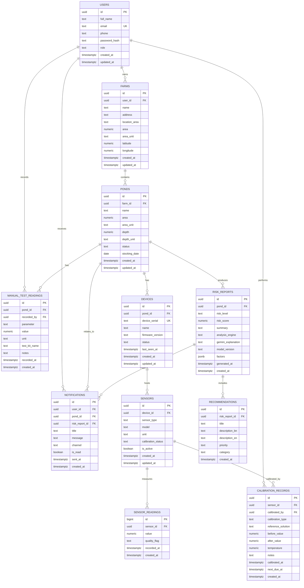

# ShrimpGuard AI — Database Design

**Database:** PostgreSQL
**Schema version:** 001 (foundation)
**Canonical DDL:** [`database/schema/001_initial_schema.sql`](../../database/schema/001_initial_schema.sql)

---

## 1. Design Goals

1. Represent **one farmer → many farms → many ponds → many historical readings**.
2. Keep sensor readings separate from manual test-kit readings.
3. Preserve the full risk-analysis trail: report → factors → recommendations.
4. Support fast historical queries by pond, sensor, parameter, and time.
5. Keep calibration history for every sensor.
6. Avoid invented sensor specifications; free-text and metadata fields hold values until confirmed.

## 2. Entity–Relationship Diagram

## 3. Table Reference

### 3.1 `users`

Stores farmers and administrative users.

| Column | Type | Notes |
|---|---|---|
| `id` | UUID PK | `gen_random_uuid()` |
| `full_name` | TEXT | Required |
| `email` | TEXT | Unique, required |
| `phone` | TEXT | Optional |
| `password_hash` | TEXT | Required; never plaintext |
| `role` | `user_role` enum | `farmer` or `admin`; default `farmer` |
| `created_at`, `updated_at` | TIMESTAMPTZ | Automatically maintained |

### 3.2 `farms`

A farm belongs to one user and contains many ponds.

| Column | Type | Notes |
|---|---|---|
| `id` | UUID PK | |
| `user_id` | UUID FK → `users.id` | `ON DELETE CASCADE` |
| `name` | TEXT | Required |
| `address` | TEXT | Optional |
| `location_area` | TEXT | Human-readable locality |
| `area` | NUMERIC(12,2) | Optional |
| `area_unit` | TEXT | Unit To Be Confirmed |
| `latitude`, `longitude` | NUMERIC(9,6) | Optional |
| `created_at`, `updated_at` | TIMESTAMPTZ | |

### 3.3 `ponds`

A pond belongs to one farm and is the main unit of monitoring.

| Column | Type | Notes |
|---|---|---|
| `id` | UUID PK | |
| `farm_id` | UUID FK → `farms.id` | `ON DELETE CASCADE` |
| `name` | TEXT | Required |
| `area`, `area_unit` | NUMERIC / TEXT | Optional |
| `depth`, `depth_unit` | NUMERIC / TEXT | Optional |
| `status` | `pond_status` enum | `active`, `inactive`, `archived` |
| `stocking_date` | DATE | Optional |
| `created_at`, `updated_at` | TIMESTAMPTZ | |

### 3.4 `devices`

An ESP32 device is assigned to one pond. A device can host multiple sensors.

| Column | Type | Notes |
|---|---|---|
| `id` | UUID PK | |
| `pond_id` | UUID FK → `ponds.id` | `ON DELETE CASCADE` |
| `device_serial` | TEXT | Unique identifier |
| `name` | TEXT | Friendly name |
| `firmware_version` | TEXT | Optional |
| `status` | `device_status` enum | `online`, `offline`, `maintenance`, `unknown` |
| `last_seen_at` | TIMESTAMPTZ | Optional |
| `created_at`, `updated_at` | TIMESTAMPTZ | |

### 3.5 `sensors`

A sensor records one parameter and belongs to a device.

| Column | Type | Notes |
|---|---|---|
| `id` | UUID PK | |
| `device_id` | UUID FK → `devices.id` | `ON DELETE CASCADE` |
| `sensor_type` | `sensor_type` enum | `ph`, `dissolved_oxygen`, `temperature`, `salinity`, `turbidity` |
| `model` | TEXT | **To Be Confirmed** |
| `unit` | TEXT | Unit for the parameter |
| `calibration_status` | `calibration_status` enum | `uncalibrated`, `calibrated`, `due`, `overdue` |
| `is_active` | BOOLEAN | Default true |
| `created_at`, `updated_at` | TIMESTAMPTZ | |

Unique constraint: `(device_id, sensor_type)` prevents duplicate parameter sensors on one device.

### 3.6 `sensor_readings`

High-volume time-series table.

| Column | Type | Notes |
|---|---|---|
| `id` | BIGSERIAL PK | Efficient append-only inserts |
| `sensor_id` | UUID FK → `sensors.id` | `ON DELETE CASCADE` |
| `value` | NUMERIC(12,4) | Required |
| `quality_flag` | `reading_quality` enum | `valid`, `suspect`, `invalid` |
| `recorded_at` | TIMESTAMPTZ | Device measurement time |
| `created_at` | TIMESTAMPTZ | Server receipt time |

Indexes: `(sensor_id, recorded_at DESC)` and `(recorded_at DESC)`.

### 3.7 `manual_test_readings`

Manual entries such as ammonia test-kit results.

| Column | Type | Notes |
|---|---|---|
| `id` | UUID PK | |
| `pond_id` | UUID FK → `ponds.id` | `ON DELETE CASCADE` |
| `recorded_by` | UUID FK → `users.id` | `ON DELETE SET NULL` |
| `parameter` | TEXT | Example: `ammonia` |
| `value` | NUMERIC(12,4) | Required |
| `unit` | TEXT | Required |
| `test_kit_name` | TEXT | Kit brand/name To Be Confirmed |
| `notes` | TEXT | Optional |
| `recorded_at` | TIMESTAMPTZ | Required |
| `created_at` | TIMESTAMPTZ | |

### 3.8 `risk_reports`

Stores one analysis result per run.

| Column | Type | Notes |
|---|---|---|
| `id` | UUID PK | |
| `pond_id` | UUID FK → `ponds.id` | `ON DELETE CASCADE` |
| `risk_level` | `risk_level` enum | `low`, `moderate`, `high`, `critical` |
| `risk_score` | NUMERIC(5,2) | Optional normalized score |
| `summary` | TEXT | Short structured summary |
| `factors` | JSONB | Exceeded thresholds, trends, anomalies |
| `analysis_engine` | TEXT | Example: `rules-v0` |
| `gemini_explanation` | TEXT | Bengali explanation; nullable |
| `model_version` | TEXT | Rules/ML version |
| `generated_at` | TIMESTAMPTZ | Analysis time |
| `created_at` | TIMESTAMPTZ | |

### 3.9 `recommendations`

Farmer actions derived from a risk report.

| Column | Type | Notes |
|---|---|---|
| `id` | UUID PK | |
| `risk_report_id` | UUID FK → `risk_reports.id` | `ON DELETE CASCADE` |
| `title` | TEXT | Required |
| `description_bn` | TEXT | Bengali recommendation |
| `description_en` | TEXT | Optional English text |
| `priority` | `priority_level` enum | `low`, `medium`, `high`, `urgent` |
| `category` | TEXT | Example: `aeration`, `water_exchange` |
| `created_at` | TIMESTAMPTZ | |

### 3.10 `notifications`

User-facing alerts.

| Column | Type | Notes |
|---|---|---|
| `id` | UUID PK | |
| `user_id` | UUID FK → `users.id` | `ON DELETE CASCADE` |
| `pond_id` | UUID FK → `ponds.id` | Nullable, `ON DELETE SET NULL` |
| `risk_report_id` | UUID FK → `risk_reports.id` | Nullable, `ON DELETE SET NULL` |
| `title` | TEXT | Required |
| `message` | TEXT | Required |
| `channel` | `notification_channel` enum | `in_app`, `push`, `sms` |
| `is_read` | BOOLEAN | Default false |
| `sent_at` | TIMESTAMPTZ | Optional |
| `created_at` | TIMESTAMPTZ | |

### 3.11 `calibration_records`

One row per calibration event.

| Column | Type | Notes |
|---|---|---|
| `id` | UUID PK | |
| `sensor_id` | UUID FK → `sensors.id` | `ON DELETE CASCADE` |
| `calibrated_by` | UUID FK → `users.id` | Nullable, `ON DELETE SET NULL` |
| `calibration_type` | TEXT | Example: two-point; exact method TBC |
| `reference_solution` | TEXT | Exact solutions To Be Confirmed |
| `before_value`, `after_value` | NUMERIC | Optional |
| `temperature` | NUMERIC | Optional, for temperature-aware calibration |
| `notes` | TEXT | Optional |
| `calibrated_at` | TIMESTAMPTZ | Required |
| `next_due_at` | TIMESTAMPTZ | Optional |
| `created_at` | TIMESTAMPTZ | |

## 4. Relationship Rules

- A user may own zero or many farms.
- A farm must belong to exactly one user.
- A pond must belong to exactly one farm.
- A device must belong to exactly one pond.
- A sensor must belong to exactly one device.
- A reading must belong to exactly one sensor.
- A manual reading must belong to exactly one pond.
- A risk report must belong to exactly one pond.
- A recommendation must belong to exactly one risk report.
- A notification may reference a pond and/or risk report, or neither.
- A calibration record must belong to exactly one sensor.

## 5. Index Strategy

- Foreign keys are indexed to support joins and deletes.
- Historical queries use `(sensor_id, recorded_at DESC)`.
- Pond-level manual history uses `(pond_id, recorded_at DESC)`.
- Risk report lookups use `(pond_id, generated_at DESC)`.
- Notifications use `(user_id, is_read, created_at DESC)`.
- Calibration lookups use `(sensor_id, calibrated_at DESC)`.

## 6. Data Retention and Integrity

- Sensor readings are append-only; corrections should be represented by `quality_flag` or new rows, not silent edits.
- Risk reports and recommendations are retained for historical comparison.
- `updated_at` columns are maintained by a shared trigger function.
- Deleting a user cascades to their farms, ponds, devices, sensors, and readings. This is intentional for this academic foundation but should be replaced with soft deletes before production.
- Units are stored with values to avoid ambiguity. Unit standards are To Be Confirmed.

## 7. Migration Strategy

- `database/schema/001_initial_schema.sql` is the canonical schema.
- `database/migrations/001_initial_schema.sql` is the transactional migration form.
- Future changes should add numbered migration files rather than editing applied migrations.
- A migration tool (for example, a Node.js migration runner or Python Alembic) is **To Be Confirmed**.

## 8. Open Items

- Final units and acceptable ranges for each parameter
- Risk score scale and thresholds (expert validation required)
- Sensor and test-kit models
- Whether pond geolocation is needed at farm or pond level
- Retention period for raw readings
- Role model beyond `farmer` and `admin`
