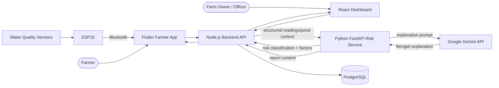
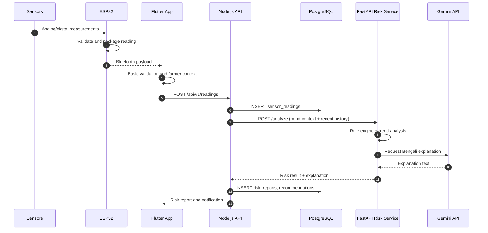
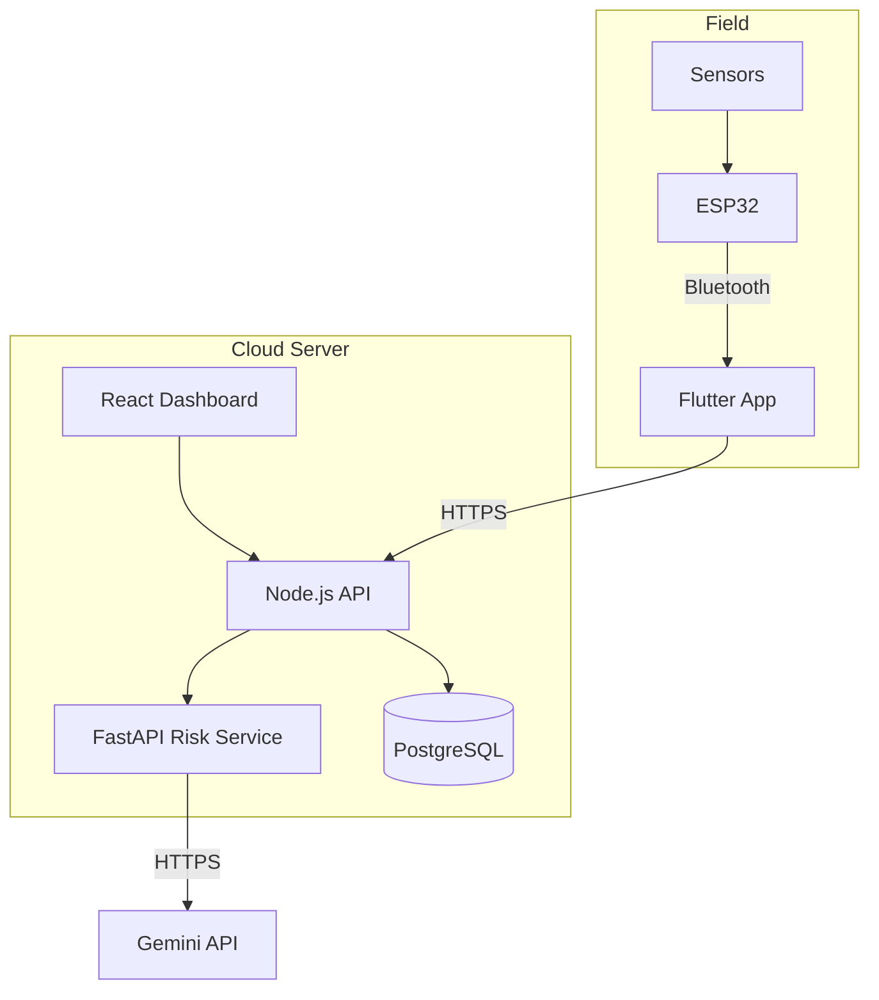

# ShrimpGuard AI — System Architecture

**Project:** ShrimpGuard AI
**Team:** CSE4104-7C-T04 · Section 7C
**Status:** Week 02 foundation

---

## 1. Purpose

This document describes the high-level architecture of ShrimpGuard AI: the hardware data path, the two backend services, the database, the clients, and the AI boundary. It is a foundation document and will be refined as implementation proceeds.

## 2. Architectural Principles

1. **Hardware is the source of water-quality measurements.** Sensor values enter the system through the ESP32 and the Flutter app.
2. **Risk decisions are rule-first.** Expert-validated rules and historical analysis classify risk. Gemini does not decide risk on its own.
3. **Two backend services, clear ownership.** Node.js owns business data and APIs. Python FastAPI owns risk analysis.
4. **Historical data is first-class.** Every reading is stored so trends, anomalies, and reports can be reconstructed.
5. **Farmer-first output.** Technical results are translated into clear Bengali explanations and recommendations.
6. **No secrets in source control.** Credentials live in environment variables only.

## 3. Component Overview

| Component | Technology | Responsibility |
|---|---|---|
| Sensor layer | pH, DO, temperature, salinity sensors | Measure physical/chemical water parameters |
| Edge controller | ESP32 | Read sensors, format readings, expose data over Bluetooth |
| Mobile client | Flutter | Pair with ESP32, collect readings, manage farms/ponds, display results in Bengali |
| Backend API | Node.js | Auth, farmers, farms, ponds, devices, readings, reports, notifications |
| Risk service | Python FastAPI | Rules, trend analysis, anomaly detection, risk classification, future ML |
| Database | PostgreSQL | Persistent storage for all entities and history |
| Web client | React.js | Monitoring dashboard for farms, ponds, readings, and risk reports |
| Explanation layer | Google Gemini API | Bengali explanation and recommendation text from structured risk results |
| Hosting | Cloud server | Runs Node.js, FastAPI, PostgreSQL, React build |

## 4. Context Diagram



> Note: the exact call direction for Gemini can be either from the Python service or through a controlled Node.js integration. The chosen foundation places Gemini usage inside the Python risk service so that generated text is always grounded in the risk result.

## 5. Data Flow

### 5.1 Sensor reading ingestion



If Gemini is unavailable or unconfigured, the risk result is still produced and stored; the explanation is marked as pending or unavailable. This preserves rule-first behavior.

### 5.2 Manual ammonia entry

1. Farmer performs a manual ammonia test kit reading.
2. Farmer enters the value and kit metadata in the Flutter app.
3. Node.js stores the entry in `manual_test_readings`.
4. The risk service includes recent manual readings in the next analysis.
5. The report clearly distinguishes sensor readings from manual readings.

### 5.3 Historical retrieval

The Flutter app and React dashboard request history from Node.js. Node.js queries PostgreSQL using pond ID, parameter, and time range. The risk service may also request history directly through a service-to-service call or through Node.js; the foundation keeps Node.js as the owner of stored data.

## 6. Service Responsibilities

### 6.1 Node.js Backend API

- Authentication and session/token handling
- Farmer profile management
- Farm and pond management
- Device registration and status
- Sensor and manual reading storage
- Historical data retrieval
- Risk report and recommendation persistence
- Notification generation and retrieval
- API management for Flutter and React clients
- Controlled calls to the Python risk service

### 6.2 Python FastAPI Risk Service

- Expert-validated water-quality rules
- Historical trend analysis
- Abnormal pattern detection
- Environmental risk classification
- Structured factor reporting
- Future custom ML model integration
- Bengali explanation generation via Gemini, with safe fallback

### 6.3 Gemini API Boundary

Gemini receives a **structured result** (risk level, exceeded parameters, trends, pond context) and produces farmer-friendly Bengali text. It must not be the only source of a risk decision. Prompts and outputs are stored with the report for traceability.

## 7. Data Model Overview

```text
User (farmer)
  └── Farm (many)
        └── Pond (many)
              ├── Device (many)
              │     └── Sensor (many)
              │           ├── Sensor Reading (many)
              │           └── Calibration Record (many)
              ├── Manual Test Reading (many)
              ├── Risk Report (many)
              │     └── Recommendation (many)
              └── Notification (many, optional per pond)
```

Full schema and ER diagram: [`DATABASE_DESIGN.md`](DATABASE_DESIGN.md).

## 8. API Surface (Foundation)

| Method | Path | Purpose | Owner |
|---|---|---|---|
| GET | `/api/v1/health` | Service health | Node.js |
| POST | `/api/v1/auth/register` | Farmer registration | Node.js |
| POST | `/api/v1/auth/login` | Farmer login | Node.js |
| GET | `/api/v1/farmers/me` | Farmer profile | Node.js |
| PUT | `/api/v1/farmers/me` | Update farmer profile | Node.js |
| GET | `/api/v1/farms` | List farms | Node.js |
| POST | `/api/v1/farms` | Create farm | Node.js |
| GET | `/api/v1/ponds` | List ponds | Node.js |
| POST | `/api/v1/ponds` | Create pond | Node.js |
| GET | `/api/v1/devices` | List devices | Node.js |
| POST | `/api/v1/readings` | Ingest sensor reading | Node.js |
| POST | `/api/v1/readings/manual` | Ingest manual ammonia reading | Node.js |
| GET | `/api/v1/readings/history` | Historical readings | Node.js |
| POST | `/api/v1/risk/analyze` | Request risk analysis | Node.js → FastAPI |
| GET | `/api/v1/risk/reports` | List risk reports | Node.js |
| GET | `/api/v1/notifications` | List notifications | Node.js |
| GET | `/health` | Service health | FastAPI |
| POST | `/analyze` | Rule-based risk analysis | FastAPI |

Paths are foundational and may be refined during implementation.

## 9. Deployment View



Deployment specifics (provider, domain, TLS termination, backing up PostgreSQL) are **To Be Confirmed**.

## 10. Security and Privacy

- Passwords are stored as hashes; plaintext passwords are never stored.
- Authentication uses signed tokens; token lifetime and refresh strategy are To Be Confirmed.
- Environment variables hold database credentials, JWT secrets, and the Gemini API key.
- `.env` files are ignored by Git; only `.env.example` templates are committed.
- Farmer and farm location data are personal data and should be access-controlled.
- Bluetooth payloads should be validated on the mobile side before upload.
- The system should log analysis inputs and outputs without logging secrets.

## 11. Failure Handling

| Failure | Behavior |
|---|---|
| Sensor disconnected | ESP32 marks the reading invalid or omits it; app shows device status |
| Bluetooth unavailable | Flutter keeps unsynced readings locally for a later retry (future enhancement) |
| Node.js unavailable | Clients show an offline/error state; readings may be queued on device |
| FastAPI unavailable | Node.js stores readings; risk analysis is retried later and marked pending |
| Expert thresholds not configured | FastAPI returns `status: not_configured`; no risk level is presented or persisted |
| Gemini unavailable | Rule-based risk report is stored with explanation marked unavailable |
| Database unavailable | API returns a controlled error; no partial report is claimed as complete |

## 12. Open Items (To Be Confirmed)

- Exact ESP32 board model and pin map
- Sensor models, interfaces, voltage levels, and measurement ranges
- Bluetooth profile/protocol and payload format
- Authentication strategy details (JWT expiry, refresh, roles)
- Gemini model name and prompt policy
- Cloud provider and deployment topology
- Chart library and state-management choices for Flutter
- Whether the risk service receives history from Node.js or queries PostgreSQL directly

These items are intentionally left open so the foundation does not invent hardware or infrastructure facts.
