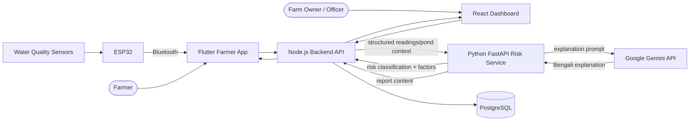
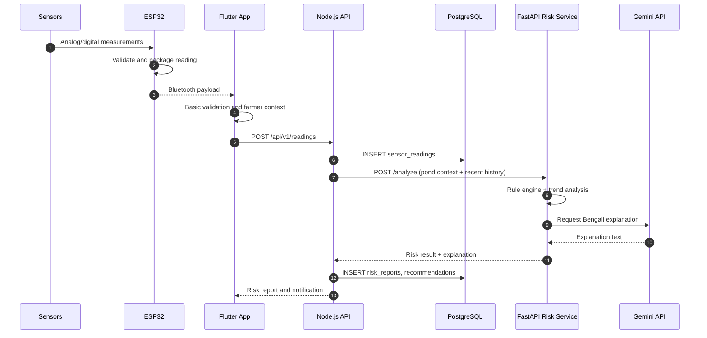
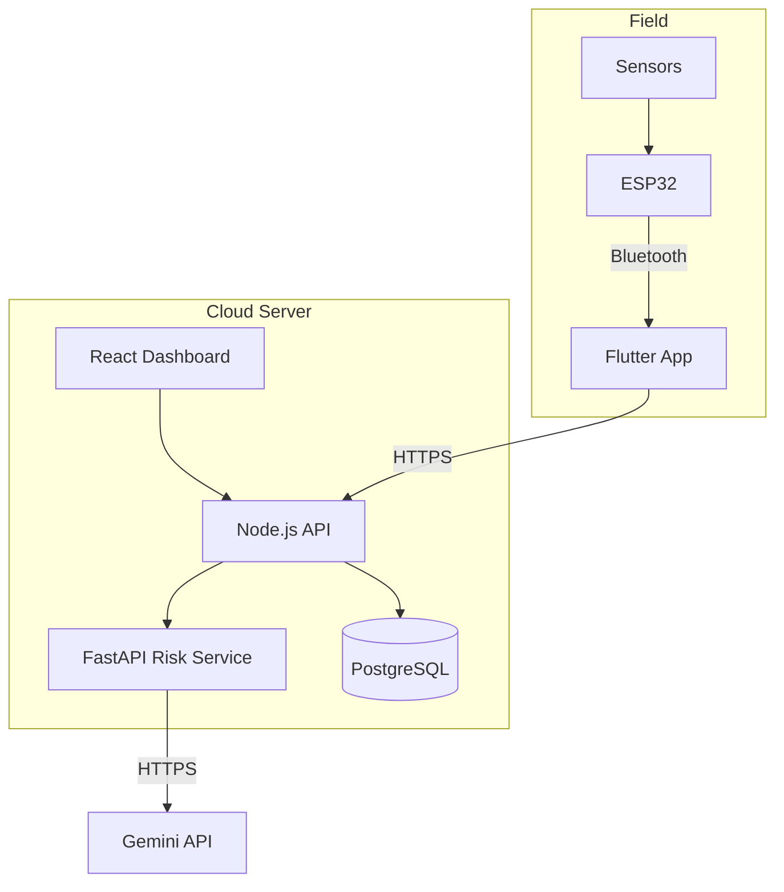

# ShrimpGuard AI — Initial System Architecture Diagram

**Course:** CSE4104
**Assignment:** Week 03
**Official Team Name:** CSE4104-7C-T04
**Section:** 7C
**Project Title:** ShrimpGuard AI — AI-Powered Shrimp Farm Water Quality & Environmental Risk Monitoring System

---

## 1. Source

The diagrams below are copied from the existing Week 02 system architecture document:

- Source file: `docs/architecture/SYSTEM_ARCHITECTURE.md`
- Source sections: Section 4 (Context Diagram), Section 5.1 (Sensor reading ingestion data flow), and Section 9 (Deployment View)
- Architecture status: Week 02 foundation

The Mermaid code is reproduced verbatim from the existing Week 02 document. It was not recreated or redesigned for Week 03.

## 2. System Architecture — Context Diagram

> Note: the exact call direction for Gemini can be either from the Python service or through a controlled Node.js integration. The chosen foundation places Gemini usage inside the Python risk service so that generated text is always grounded in the risk result.

## 3. Data Flow — Sensor Reading Ingestion

If Gemini is unavailable or unconfigured, the risk result is still produced and stored; the explanation is marked as pending or unavailable. This preserves rule-first behavior.

## 4. Deployment View

Deployment specifics (provider, domain, TLS termination, backing up PostgreSQL) are **To Be Confirmed**.

## 5. Brief Explanation

1. **Field layer:** Water-quality sensors measure pH, dissolved oxygen, temperature, and salinity. The ESP32 reads and packages the measurements and exposes them to the Flutter farmer application over Bluetooth.
2. **Client layer:** The Flutter application is the farmer-facing client. It manages farm and pond context, collects readings, accepts manual ammonia entries, and displays history, risk reports, Bengali explanations, recommendations, and notifications. The React.js dashboard provides monitoring and administration views.
3. **Service layer:** The Node.js backend owns authentication, farmer and farm management, pond management, sensor data management, historical retrieval, risk report management, notifications, and API management. The Python FastAPI service owns water-quality analysis, expert-validated rule-based risk classification, historical trend analysis, abnormal pattern detection, and environmental risk assessment.
4. **Data layer:** PostgreSQL stores users, farms, ponds, devices, sensors, sensor readings, manual test readings, risk reports, recommendations, notifications, and calibration records.
5. **AI boundary:** The Python FastAPI service performs risk classification first. It then sends the validated risk result to the Gemini API for a Bengali explanation and farmer-friendly recommendation text. Gemini does not decide the risk level and cannot override the validated classification. If Gemini is unavailable, the rule-based report is still produced and stored.
6. **Deployment:** The Node.js API, FastAPI service, PostgreSQL database, and React build are intended for a cloud server. The ESP32 does not call the internet directly in the current architecture; the Flutter application is responsible for uploading readings to the backend.

## 6. Consistency Note

The copied Week 02 context diagram includes an `Officer / Farm Owner` actor. The confirmed role model for Week 03 is **Shrimp Farmer** and **System Admin**, as supported by the database design and the React dashboard scope. The `Officer / Farm Owner` actor is therefore retained only because this file reproduces the Week 02 diagram verbatim. The team should confirm whether this is a separate role or an earlier label for an existing role. The Week 03 use case diagram uses only Farmer and Admin.

The architecture diagrams also show the intended Week 02 foundation. They do not imply that every component is fully implemented. The current repository contains service skeletons, placeholder screens, and foundation risk-analysis logic.
