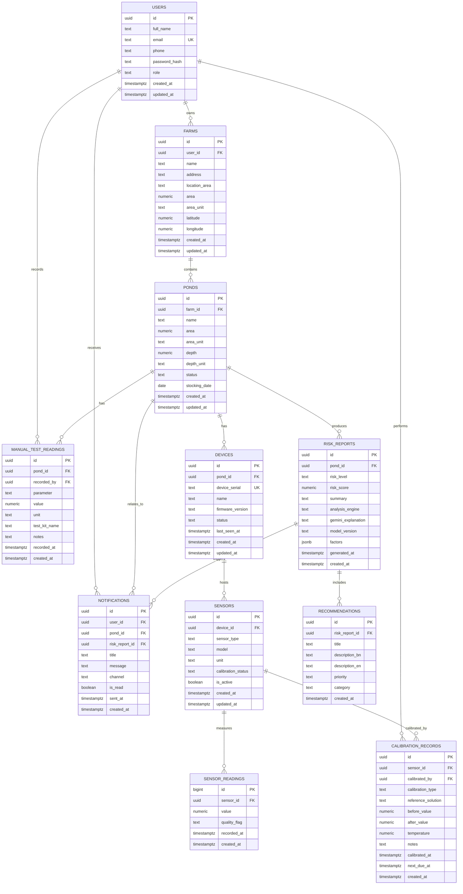

# ShrimpGuard AI — Entity Relationship Diagram

**Course:** CSE4104
**Assignment:** Week 03
**Official Team Name:** CSE4104-7C-T04
**Section:** 7C
**Project Title:** ShrimpGuard AI — AI-Powered Shrimp Farm Water Quality & Environmental Risk Monitoring System

---

## 1. Source

This diagram is copied from the existing Week 02 database design document:

- Source file: `docs/architecture/DATABASE_DESIGN.md`
- Source section: Section 2, Entity–Relationship Diagram
- Schema version: 001 (foundation)
- Canonical DDL: `database/schema/001_initial_schema.sql`

The Mermaid code below is reproduced verbatim from the existing Week 02 document. It was not recreated or redesigned for Week 03.

## 2. Entity–Relationship Diagram

## 3. Brief Explanation

The diagram models the core data relationships of ShrimpGuard AI:

1. **User ownership:** A `USERS` record represents a farmer or administrator. One user may own many `FARMS`.
2. **Farm and pond hierarchy:** A farm contains many `PONDS`. The pond is the main unit of environmental monitoring.
3. **Device and sensor hierarchy:** A pond may have many `DEVICES`, and each ESP32 device may host many `SENSORS`. Each sensor produces many `SENSOR_READINGS`.
4. **Manual readings:** `MANUAL_TEST_READINGS` are linked directly to a pond and a recording user. They are intentionally separate from automatic sensor readings so that manual ammonia results remain distinguishable.
5. **Risk analysis trail:** Each pond may produce many `RISK_REPORTS`. A risk report contains the validated risk level, score, summary, analysis engine, model version, structured factors, and optional Gemini explanation.
6. **Recommendations and notifications:** A risk report may include many `RECOMMENDATIONS` and may trigger many `NOTIFICATIONS`. Notifications are also linked to a user and may reference a pond or risk report.
7. **Calibration history:** `CALIBRATION_RECORDS` preserve the calibration history for each sensor and record the user who performed the calibration.

The diagram is consistent with the established AI boundary: the risk report stores the rule-based analysis metadata and, separately, the optional Gemini explanation. The explanation is not the source of the risk classification.
