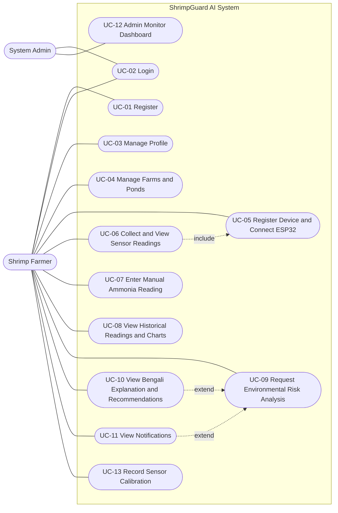

# ShrimpGuard AI — Use Case Diagram

**Course:** CSE4104
**Assignment:** Week 03
**Official Team Name:** CSE4104-7C-T04
**Section:** 7C
**Project Title:** ShrimpGuard AI — AI-Powered Shrimp Farm Water Quality & Environmental Risk Monitoring System
**Diagram Source:** Derived from the functional requirements and use cases in `CSE4104-7C-T04_SRS.md`

---

## 1. Use Case Diagram

> Mermaid.js does not provide a native UML use-case diagram type. The diagram below uses Mermaid flowchart syntax to represent actors, the system boundary, use cases, and UML-style `include` and `extend` relationships.

## 2. Diagram Explanation

1. **Actors:** The diagram defines two actors supported by the established project scope: the **Shrimp Farmer** and the **System Admin**. No additional role is introduced.
2. **System boundary:** All use cases are placed inside the **ShrimpGuard AI System** boundary. The ESP32, sensors, Node.js backend, Python FastAPI service, PostgreSQL, Gemini API, and React dashboard are internal or supporting system components rather than separate human actors.
3. **Farmer use cases:** The farmer registers and logs in, manages the farmer profile, manages farms and ponds, registers a device and connects the ESP32, collects and views sensor readings, enters manual ammonia results, views historical readings and charts, requests environmental risk analysis, views Bengali explanations and recommendations, views notifications, and records sensor calibration where supported.
4. **Admin use cases:** The administrator logs in and accesses the React monitoring dashboard. The admin role is limited to the dashboard monitoring and administration scope supported by the existing project documentation.
5. **`include` relationship:** UC-06 *(Collect and View Sensor Readings)* includes UC-05 *(Register Device and Connect ESP32)* because a valid Bluetooth connection and device context are required before a reading can be collected and accepted.
6. **`extend` relationships:** UC-10 *(View Bengali Explanation and Recommendations)* extends UC-09 *(Request Environmental Risk Analysis)* because the explanation and recommendation view is optional if Gemini is unavailable. UC-11 *(View Notifications)* is shown as an optional extension because a risk report may produce a notification that the farmer can later view.
7. **Authentication:** UC-02 *(Login)* is required before the authenticated farmer and administrator use cases are available. It is not drawn as an `include` from every use case in order to keep the diagram readable.
8. **AI boundary:** Risk classification is an internal step of UC-09 and is performed by the Python FastAPI service. Gemini only generates Bengali explanation and recommendation text after the validated risk result exists. Gemini is not an actor and does not control the risk level.

## 3. Traceability to Functional Requirements

| Use Case | Related Functional Requirements |
|---|---|
| UC-01 Register | FR-01 |
| UC-02 Login | FR-02, FR-22 |
| UC-03 Manage Profile | FR-03 |
| UC-04 Manage Farms and Ponds | FR-04, FR-05 |
| UC-05 Register Device and Connect ESP32 | FR-06, FR-07 |
| UC-06 Collect and View Sensor Readings | FR-08, FR-09, FR-11 |
| UC-07 Enter Manual Ammonia Reading | FR-10, FR-11 |
| UC-08 View Historical Readings and Charts | FR-12, FR-13 |
| UC-09 Request Environmental Risk Analysis | FR-14, FR-15, FR-16, FR-17, FR-19 |
| UC-10 View Bengali Explanation and Recommendations | FR-17, FR-18 |
| UC-11 View Notifications | FR-19, FR-20 |
| UC-12 Admin Monitor Dashboard | FR-21, FR-22 |
| UC-13 Record Sensor Calibration | FR-23 |

## 4. Notes and Open Items

1. The `admin` role is present in the database design, and the React dashboard is described as a monitoring and administration interface. The exact admin permissions remain **To Be Confirmed**.
2. The Week 02 architecture context diagram includes an `Officer / Farm Owner` actor. That actor is not part of the confirmed Farmer and Admin role model and is therefore not shown in this Week 03 use case diagram.
3. The dedicated farmer-facing calibration screen is not confirmed as implemented. UC-13 specifies the intended behavior and data requirement.
