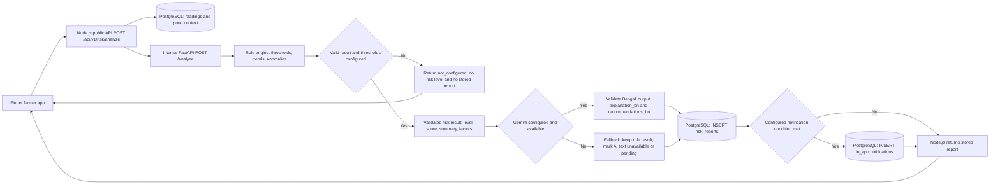

# ShrimpGuard AI — AI Integration Workflow

**Course:** CSE4104  
**Assignment:** Week 04 — System Design & Software Architecture  
**Official Team Name:** CSE4104-7C-T04 · **Section:** 7C  
**Project Title:** ShrimpGuard AI — AI-Powered Shrimp Farm Water Quality & Environmental Risk Monitoring System  
**Document Status:** Week 04 planned design — **not fully implemented**

---

## 1. Why AI Is Needed

Shrimp farmers receive numerical water-quality measurements (pH, dissolved oxygen, temperature, salinity, and manually tested ammonia) that are difficult to interpret without context. A value outside a validated range is more useful when the farmer also understands **what it means for the pond environment** and **what practical verification steps to take next**.

Many farmers in the target user group prefer Bengali, and technical terminology in English creates a barrier to timely action. ShrimpGuard AI therefore separates two concerns:

1. A deterministic rule-based service decides **whether environmental risk exists** and how severe it is.
2. A generative layer translates that validated result into clear Bengali explanation and farmer-friendly recommendation text.

The AI layer is an **accessibility and communication layer**, not an authority on risk and not a substitute for an aquaculture expert. It never claims to diagnose shrimp disease (for example, WSSV) from water-quality readings.

## 2. AI Service & Model

| Component | Technology | Role | Status |
|---|---|---|---|
| Risk Analysis Service | Python, FastAPI | Applies expert-validated thresholds, available historical trends, and anomaly evidence; produces risk level, score, summary, and structured factors. | Foundation rules exist; final expert thresholds are **To Be Confirmed**. |
| Explanation Layer | Google Gemini API | Generates Bengali `explanation_bn` and `recommendations_bn` **from the already validated risk result**. It cannot change the risk level or invent measurements. | Planned integration; key and model are server-side environment variables. |
| Future ML | Scikit-learn | Custom trained model for improved environmental risk prediction using clean labeled historical data. | **Future scope only**; not part of current risk classification. |

**Decision boundary:** FastAPI classifies risk first. Gemini is called only after a valid rule-based result exists. If thresholds are not configured, FastAPI returns `status: not_configured`, no risk level is assigned, and no `risk_reports` row is written because `risk_reports.risk_level` is `NOT NULL` in the canonical schema.

**Implementation gap to resolve:** the approved target design (Week 04 prompt, SRS FR-17/FR-18, and `risk_reports` schema) states that Gemini produces both Bengali fields. The current FastAPI foundation instead builds generic `recommendations` with `build_recommendations()` and asks Gemini only for `explanation_bn`. The team must confirm and implement the target mapping of Gemini text into `recommendations_bn`; this document does not silently treat the stub as the final design.

## 3. AI Input

Node.js sends only validated, necessary context to the internal FastAPI service:

- **Sensor readings:** pH, dissolved oxygen, temperature, and salinity, each with value, unit, timestamp, and `source: "sensor"`. These originate from the ESP32 over Bluetooth.
- **Manual reading:** ammonia with value, unit, timestamp, and `source: "manual"`. It is entered by the farmer from a test kit and is never labeled as an ESP32 sensor measurement.
- **Validated risk result:** `risk_level`, `risk_score`, `summary`, structured `factors`, and available `trends`/`anomalies` evidence.
- **Pond context:** `pond_id` and non-sensitive monitoring context needed to explain the result (for example, active status or available history). Farmer identity, email, phone, password hashes, and precise personal location are **not** sent to Gemini.
- **Language directive:** Bengali (`bn`) output.

Incomplete or invalid readings are rejected before analysis. If only some readings are available, the system evaluates what is valid and indicates that any unavailable trend evidence could not be fully assessed; it does not invent a classification from missing parameters.

## 4. AI Output and Storage

| Output | Schema field | Purpose |
|---|---|---|
| Bengali explanation | `risk_reports.explanation_bn` (nullable `TEXT`) | Explains the validated environmental risk in simple Bengali. |
| Bengali recommendations | `risk_reports.recommendations_bn` (nullable `TEXT`) | Suggests practical, non-prescriptive next steps based on the validated factors. |

Before storage, Node.js/FastAPI validation must confirm that generated text is non-empty, in Bengali, and consistent with the validated result. Generated text must not add new measurements, change the risk level, prescribe chemical dosing, or assert a shrimp disease diagnosis. Exact length and profanity/format limits are **To Be Confirmed**; the planned rule is conservative validation only.

On success, `risk_reports` stores the rule-based `risk_level`, `risk_score`, `summary`, `factors` JSONB, `analysis_engine`, `model_version`, `generated_at`, and the validated Bengali text fields. If Gemini is unavailable, the rule-based report is still stored with `explanation_bn` and `recommendations_bn` left `null`; clients show an **unavailable/pending** state, not a fabricated explanation.

## 5. AI Processing Workflow

The same sequence is used by the Activity Diagram and API Design: the client talks only to Node.js; Node.js persists accepted readings and calls FastAPI; FastAPI classifies before any Gemini call; Node.js stores the final report and optional notification, then returns the result to Flutter.

## 6. Reliability & Security

1. **Server-side key protection:** the Gemini API key and model name live in environment variables on the risk service. They are never placed in Flutter/React code, API responses, logs, or repositories.
2. **Service isolation:** Flutter and React cannot call FastAPI or Gemini directly. Only Node.js reaches the internal service; only the risk service reaches Gemini.
3. **Input validation:** Node.js validates ownership and schema; FastAPI validates request types. Unconfigured thresholds yield `not_configured` rather than a guessed risk level.
4. **Output validation:** generated Bengali text is checked before storage. Text that contradicts the rule-based result, invents measurements, or gives unsafe treatment advice is rejected and treated as unavailable.
5. **Timeout and fallback:** a Gemini timeout or error (the NFR-02 target is 20 seconds before fallback) leaves the rule-based risk level unchanged. Missing key, invalid response, or empty text produces the same safe fallback.
6. **Failure of FastAPI:** readings remain stored and analysis is marked `pending`; no risk level is claimed.
7. **No diagnosis claims:** output is limited to environmental risk, verification, and consultation advice. The system never claims to diagnose WSSV or any other shrimp disease.
8. **Traceability:** `analysis_engine`, `model_version`, `generated_at`, and structured factors are stored with each report. Logs must record analysis state without secrets or personal data.
9. **Planned status:** the prompts, exact model version, output limits, and final expert-reviewed Bengali wording remain **To Be Confirmed**. This workflow specifies the intended design; full Gemini integration is not yet implemented in the repository.
