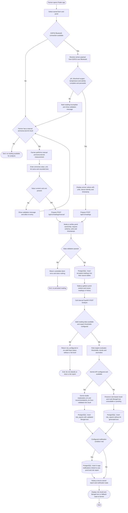

# ShrimpGuard AI — UML Activity Diagram

**Course:** CSE4104  
**Assignment:** Week 04 — System Design & Software Architecture  
**Official Team Name:** CSE4104-7C-T04 · **Section:** 7C  
**Project Title:** ShrimpGuard AI — AI-Powered Shrimp Farm Water Quality & Environmental Risk Monitoring System  
**Core Feature:** Sensor Reading Collection and Environmental Risk Analysis Workflow

---

## 1. UML Activity Diagram

> The diagram uses Mermaid `flowchart TD` syntax to represent a UML Activity Diagram. Solid rectangular nodes are activities, diamond nodes are decisions, cylinder nodes are persistent data stores, and rounded nodes are start/end states.

## 2. Technical Explanation

The workflow begins with the farmer selecting an owned farm and pond in the Flutter application. Bluetooth availability is checked before any sensor payload is accepted. When connected, the ESP32 supplies the four confirmed sensor parameters — pH, dissolved oxygen, temperature, and salinity — each with a unit and timestamp. Ammonia is a **separate, optional manual test-kit input**; it is never represented as an ESP32 sensor measurement. If Bluetooth is unavailable, the farmer may still record a manual ammonia result, but no analysis is performed when no valid reading is available.

Node.js validates pond ownership, request structure, units, and timestamps before persisting only the accepted source rows: `sensor_readings` for ESP32 data and/or `manual_test_readings` for ammonia data. Node.js then assembles pond context, recent readings, and available history and calls the internal Python FastAPI service at `POST /analyze`. Flutter and React never call FastAPI directly.

FastAPI checks that valid input data and expert-validated thresholds are available. If thresholds are not configured, it returns `not_configured`; if there is no valid input, no classification is attempted. In either case no risk level is presented or persisted, because `risk_reports.risk_level` is `NOT NULL` in the canonical schema. Otherwise, the rule engine classifies environmental risk from configured thresholds, available trends, and anomalies. Gemini is called only **after** this result exists and drafts the Bengali `explanation_bn` and `recommendations_bn` text; a Gemini timeout or failure leaves the rule-based result unchanged and marks the text unavailable or pending.

The Node.js service stores the completed analysis in `risk_reports`. If the configured notification condition is met, an in-app `notifications` row is created. The exact notification trigger condition remains **To Be Confirmed** in the SRS, so this diagram represents it as a decision rather than inventing a threshold. Finally, Node.js returns the stored report and notification state to Flutter for display. This document describes **planned** behavior; the current repository contains foundation skeletons, not a fully implemented workflow.
