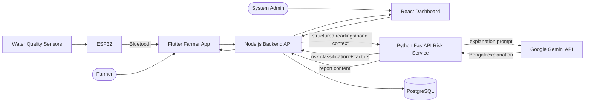
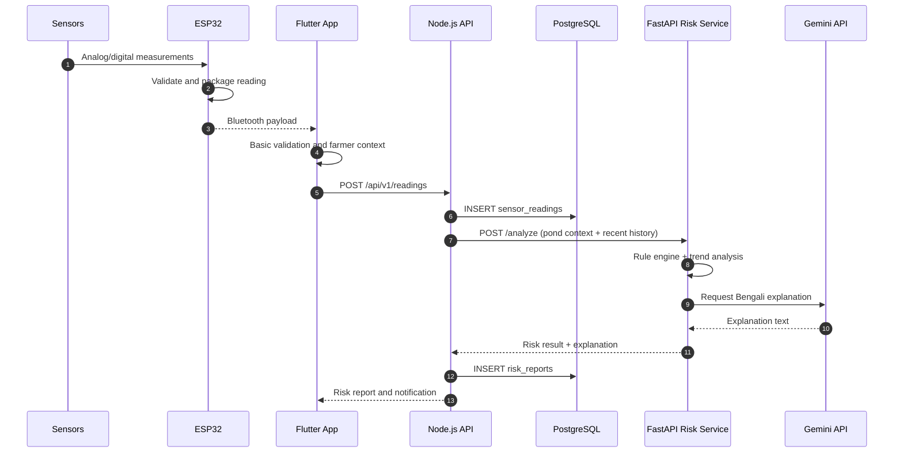
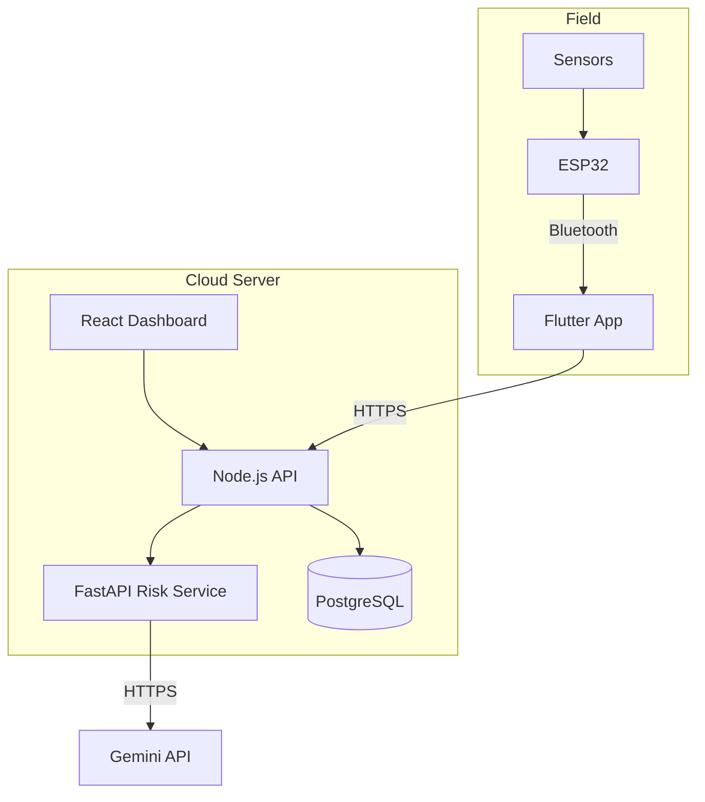
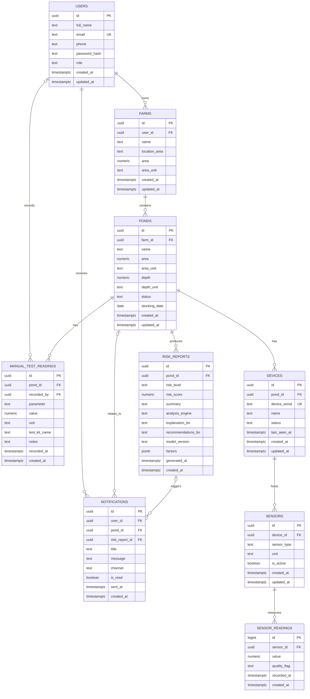
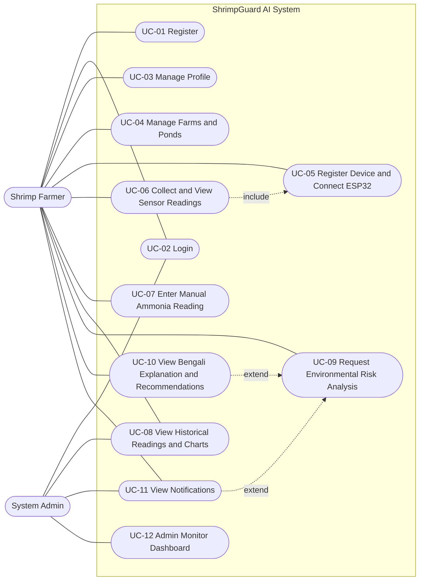
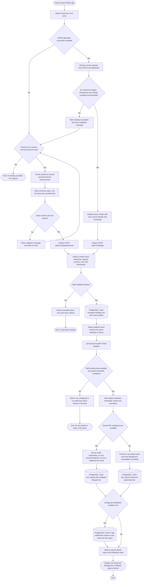
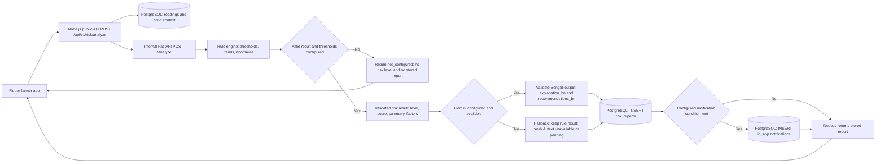

# 1. Cover Page

# ShrimpGuard AI

## System Design & Software Architecture

**Course:** CSE4104  
**Assignment:** Week 04 — System Design & Software Architecture  
**Official Team Name:** CSE4104-7C-T04  
**Section:** 7C  
**Project Title:** ShrimpGuard AI — AI-Powered Shrimp Farm Water Quality & Environmental Risk Monitoring System  
**Document Version:** 1.0  
**Document Status:** Week 04 deliverable (design specification; implementation is planned, not complete)  
**Date:** 23 November 2026

> **Academic integrity note:** This document reuses and integrates verified Week 02 and Week 03 project documentation. No Week 01 document exists in the workspace, and no Week 01 content is invented. All diagrams are kept as clean Mermaid blocks for direct Markdown-to-PDF export.

---

# 2. Team Information

| Role | Name | Student ID | GitHub |
|---|---|---|---|
| Team Leader | Shefa Hassan Shefa | 11230121166 | [shefa-dev](https://github.com/shefa-dev) |
| Team Member | Gourab Mondal | 11230321547 | [Grb-47](https://github.com/Grb-47) |
| Team Member | Shahreia Alam | 11230321561 | [shahreia](https://github.com/shahreia) |

- **Official Team Name:** CSE4104-7C-T04
- **Section:** 7C
- **Role model:** strictly **Shrimp Farmer** and **System Admin**; no other role is introduced.

---

# 3. Project Information

## 3.1 Project Overview

Shrimp farming depends on stable water quality. Unsafe pH, dissolved oxygen, temperature, salinity, or ammonia levels can stress shrimp and cause serious loss, while manual testing and delayed expert advice make early intervention difficult. ShrimpGuard AI combines ESP32-based sensors, Bluetooth transfer to a Flutter mobile application, a Node.js/Express backend, PostgreSQL, a Python/FastAPI risk-analysis service, a React.js monitoring dashboard, and the Google Gemini API for Bengali explanation and recommendation text.

## 3.2 Confirmed Scope Guardrails

| Area | Decision enforced in this document |
|---|---|
| Database | Strictly nine tables: `users`, `farms`, `ponds`, `devices`, `sensors`, `sensor_readings`, `manual_test_readings`, `risk_reports`, `notifications`. No `calibration_records` table and no separate `recommendations` table. |
| Risk report fields | Bengali text is stored in `risk_reports.explanation_bn` and `risk_reports.recommendations_bn`. |
| Roles | `farmer` and `admin` only, matching the `user_role` enum. |
| Sensor sources | pH, dissolved oxygen, temperature, and salinity come from ESP32 sensors. Ammonia is entered manually from a test kit and is never presented as an ESP32 sensor measurement. |
| AI boundary | The FastAPI rule engine determines the risk level. Gemini only generates Bengali explanation and recommendation text from the validated result. On failure, the rule-based result remains and AI text is marked unavailable/pending. No shrimp disease diagnosis is claimed. |
| API boundary | Public client APIs use `/api/v1/` on Node.js. FastAPI `/analyze` and `/health` are internal only. Admin APIs are read-only (`GET`). |
| Status | All Week 04 APIs and workflows are **planned**; the repository currently contains service skeletons and foundation logic. |

## 3.3 Technology Stack

| Layer | Technology |
|---|---|
| Hardware | ESP32; pH, dissolved oxygen, temperature, and salinity sensors; manual ammonia test kit |
| Connectivity | Bluetooth (ESP32 → Flutter) |
| Mobile | Flutter |
| Web dashboard | React.js |
| Main backend | Node.js / Express |
| Internal risk service | Python / FastAPI |
| Database | PostgreSQL |
| AI explanation | Google Gemini API |
| Future ML | Scikit-learn (future scope only) |
| Hosting | Cloud server (provider and topology To Be Confirmed) |

## 3.4 Source Documents

This design is based on the verified workspace files: `README.md`, `docs/proposal/CSE4104-7C-T04_Proposal.md`, `docs/planning/INITIAL_PROJECT_PLAN.md`, `docs/architecture/SYSTEM_ARCHITECTURE.md`, `docs/architecture/DATABASE_DESIGN.md`, `database/schema/001_initial_schema.sql`, and the Week 03 SRS and diagrams in `docs/srs/`. Source of truth for all IDs, constraints, and columns is the SQL schema.

---

# 4. System Architecture Diagram

The following diagrams are reused from `docs/srs/CSE4104-7C-T04_ArchitectureDiagram.md`, reviewed against `SYSTEM_ARCHITECTURE.md`, and retained because they already cover sensors, ESP32, Bluetooth, Flutter, React, Node.js, FastAPI, PostgreSQL, and Gemini.

## 4.1 Context Diagram



> The foundation places Gemini usage inside the Python risk service so that generated text is grounded in the risk result.

## 4.2 Data Flow — Sensor Reading Ingestion



## 4.3 Deployment View



**Interpretation:** the field layer measures and transfers readings over Bluetooth; Node.js owns business data and all client-facing APIs; FastAPI owns rule-based risk classification; Gemini only explains validated results. The ESP32 does not call the internet directly. Deployment specifics remain To Be Confirmed.

---

# 5. ER Diagram

The entity–relationship diagram is reused from `docs/srs/CSE4104-7C-T04_ERDiagram.md`. Its optional cardinality markers were aligned with the nullable foreign keys in `database/schema/001_initial_schema.sql`.



**Key constraints:** nine tables only; all primary keys are UUID except `sensor_readings.id BIGSERIAL`; `email` and `device_serial` are unique; `(device_id, sensor_type)` is unique; `risk_reports.risk_level` is `NOT NULL` while `explanation_bn` and `recommendations_bn` are nullable; `manual_test_readings.recorded_by`, `notifications.pond_id`, and `notifications.risk_report_id` are optional (`ON DELETE SET NULL`).

---

# 6. Updated Use Case Diagram

The diagram is reused from the updated `docs/srs/CSE4104-7C-T04_UseCaseDiagram.md`. `Admin --- UC08` and `Admin --- UC11` were added because the SRS names System Admin as a primary actor for UC-08 and UC-11.



**Consistency note:** the Use Case Summary and detailed UC-08/UC-11 descriptions in the SRS list both Shrimp Farmer and System Admin. The diagram now matches. Admin access remains monitoring and review; the Week 04 Admin API section is strictly `GET`. The SRS mention of marking notifications read for an admin is an open item requiring team confirmation and is not implemented as an admin mutation endpoint.

---

# 7. Activity Diagram

Reused from `docs/system-design/CSE4104-7C-T04_ActivityDiagram.md`.

## 7.1 UML Activity Diagram — Sensor Reading Collection and Environmental Risk Analysis Workflow

> Rectangular nodes are activities, diamonds are decisions, cylinders are persistent stores, and rounded nodes are start/end states.



## 7.2 Technical Explanation

The farmer selects an owned farm and pond, then the Flutter app checks the ESP32 Bluetooth connection. Sensor readings (pH, dissolved oxygen, temperature, salinity) and manually entered ammonia are **separate input paths**, not alternatives that replace one another. Node.js validates ownership, schema, units, and timestamps before inserting accepted rows into `sensor_readings` and/or `manual_test_readings`. It then gathers pond context and history and calls the internal FastAPI `/analyze` service.

FastAPI classifies only when valid data and expert thresholds exist; otherwise it returns `not_configured` or a no-valid-input status without assigning a risk level. Gemini is called after classification to draft `explanation_bn` and `recommendations_bn`; failure leaves the rule-based result intact and marks Bengali text unavailable/pending. Node.js stores the report in `risk_reports`, creates an in-app notification only when the configured condition is met, and returns the result to Flutter. The exact notification condition remains To Be Confirmed.

---

# 8. API Design Document

Reproduced from `docs/system-design/CSE4104-7C-T04_APIDesign.md`. All endpoints below are **planned**; current Node.js routes are mostly `501 Not Implemented`.

## 8.1 Status, Boundaries, and Conventions

| Label | Meaning |
|---|---|
| **[ARCH-8]** | Explicitly listed in `SYSTEM_ARCHITECTURE.md` Section 8. |
| **[SRS]** | Required by an SRS functional requirement or detailed use case but not listed verbatim in Section 8. |
| **[PROPOSED]** | Proposed design decision needed to expose the requirement as a REST endpoint; team confirmation required. |

- Public client APIs use `/api/v1/` on Node.js/Express; FastAPI exposes only internal `POST /analyze` and `GET /health`. Flutter and React never call FastAPI or Gemini directly.
- Authentication uses a proposed `Authorization: Bearer <token>` header; token strategy details remain To Be Confirmed. Roles are `farmer` and `admin`.
- IDs are UUID strings except `sensor_readings.id`, which is `bigint`. JSON keys use `camelCase` for Node.js responses and `snake_case` for FastAPI responses, matching the source models. Units are shown as `TBC` to avoid inventing specifications.
- Gemini keys, database credentials, and token secrets are server-side environment variables only; they never appear in requests or responses.
- Admin Monitoring endpoints are strictly `GET`. Current notification delivery is `in_app`; `push` and `sms` are future scope.
- `not_configured` and `pending` are statuses, not stored risk levels; neither creates a `risk_reports` row because `risk_level` is `NOT NULL`.

Common status codes: `200 OK`, `201 Created`, `204 No Content`, `400 Bad Request`, `401 Unauthorized`, `403 Forbidden`, `404 Not Found`, `409 Conflict`, `422 Unprocessable Entity`, `503 Service Unavailable`. Example error body:

```json
{ "error": { "code": "FORBIDDEN", "message": "The selected pond does not belong to the authenticated farmer." } }
```

## 8.2 Authentication

### 8.2.1 Register Farmer
- **API Name:** Farmer Registration
- **HTTP Method & URL:** `POST /api/v1/auth/register` **[ARCH-8]**
- **Purpose:** Create a farmer account with a hashed password (SRS FR-01, UC-01).
- **Auth/Role:** None (public).
- **Request Body:**
  ```json
  { "fullName": "Shefa Hassan Shefa", "email": "farmer@example.test", "phone": "01XXXXXXXXX", "password": "example-password" }
  ```
- **Expected HTTP Status:** `201 Created`; `400`, `409`, `422`, `500`.
- **Expected Response JSON:**
  ```json
  { "id": "11111111-1111-4111-8111-111111111111", "fullName": "Shefa Hassan Shefa", "email": "farmer@example.test", "phone": "01XXXXXXXXX", "role": "farmer", "createdAt": "2026-11-23T08:00:00Z" }
  ```
- **Related DB Table(s):** `users` (`password_hash` is persisted, never returned).

### 8.2.2 Login
- **API Name:** User Login
- **HTTP Method & URL:** `POST /api/v1/auth/login` **[ARCH-8]**
- **Purpose:** Authenticate a farmer or system admin and issue a signed token (FR-02, UC-02).
- **Auth/Role:** None (public).
- **Request Body:**
  ```json
  { "email": "farmer@example.test", "password": "example-password" }
  ```
- **Expected HTTP Status:** `200 OK`; `400`, `401`, `422`.
- **Expected Response JSON:**
  ```json
  { "token": "<signed-token>", "tokenType": "Bearer", "user": { "id": "11111111-1111-4111-8111-111111111111", "fullName": "Shefa Hassan Shefa", "email": "farmer@example.test", "role": "farmer" } }
  ```
- **Related DB Table(s):** `users`.

## 8.3 User / Profile

### 8.3.1 Get Current Profile
- **API Name:** Get Farmer Profile
- **HTTP Method & URL:** `GET /api/v1/farmers/me` **[ARCH-8]**
- **Purpose:** Return the authenticated farmer's profile (FR-03, UC-03).
- **Auth/Role:** Authenticated Shrimp Farmer.
- **Request Body/Params:** None.
- **Expected HTTP Status:** `200 OK`; `401`, `404`.
- **Expected Response JSON:**
  ```json
  { "id": "11111111-1111-4111-8111-111111111111", "fullName": "Shefa Hassan Shefa", "email": "farmer@example.test", "phone": "01XXXXXXXXX", "role": "farmer", "createdAt": "2026-11-23T08:00:00Z", "updatedAt": "2026-11-23T08:00:00Z" }
  ```
- **Related DB Table(s):** `users`.

### 8.3.2 Update Current Profile
- **API Name:** Update Farmer Profile
- **HTTP Method & URL:** `PUT /api/v1/farmers/me` **[ARCH-8]**
- **Purpose:** Update full name and phone number (FR-03, UC-03).
- **Auth/Role:** Authenticated Shrimp Farmer.
- **Request Body:**
  ```json
  { "fullName": "Shefa Hassan Shefa", "phone": "01XXXXXXXXX" }
  ```
- **Expected HTTP Status:** `200 OK`; `400`, `401`, `422`.
- **Expected Response JSON:**
  ```json
  { "id": "11111111-1111-4111-8111-111111111111", "fullName": "Shefa Hassan Shefa", "email": "farmer@example.test", "phone": "01XXXXXXXXX", "role": "farmer", "updatedAt": "2026-11-23T09:00:00Z" }
  ```
- **Related DB Table(s):** `users`.

## 8.4 Farms

### 8.4.1 List Farms
- **API Name:** List Owned Farms
- **HTTP Method & URL:** `GET /api/v1/farms` **[ARCH-8]**
- **Purpose:** List farms owned by the authenticated farmer (FR-04, UC-04).
- **Auth/Role:** Authenticated Shrimp Farmer.
- **Request Body/Params:** Query: `limit=20`, `offset=0` (proposed pagination).
- **Expected HTTP Status:** `200 OK`; `401`.
- **Expected Response JSON:**
  ```json
  { "items": [ { "id": "33333333-3333-4333-8333-333333333333", "userId": "11111111-1111-4111-8111-111111111111", "name": "Coastal Farm 1", "locationArea": "Satkhira", "area": 2.5, "areaUnit": "TBC", "createdAt": "2026-11-23T08:05:00Z" } ], "limit": 20, "offset": 0 }
  ```
- **Related DB Table(s):** `farms`.

### 8.4.2 Create Farm
- **API Name:** Create Farm
- **HTTP Method & URL:** `POST /api/v1/farms` **[ARCH-8]**
- **Purpose:** Create a farm owned by the authenticated farmer (FR-04).
- **Auth/Role:** Authenticated Shrimp Farmer.
- **Request Body:**
  ```json
  { "name": "Coastal Farm 1", "locationArea": "Satkhira", "area": 2.5, "areaUnit": "TBC" }
  ```
- **Expected HTTP Status:** `201 Created`; `400`, `401`, `422`.
- **Expected Response JSON:**
  ```json
  { "id": "33333333-3333-4333-8333-333333333333", "userId": "11111111-1111-4111-8111-111111111111", "name": "Coastal Farm 1", "locationArea": "Satkhira", "area": 2.5, "areaUnit": "TBC", "createdAt": "2026-11-23T08:05:00Z" }
  ```
- **Related DB Table(s):** `farms`.

### 8.4.3 Get Farm by ID
- **API Name:** Get Farm Details
- **HTTP Method & URL:** `GET /api/v1/farms/{farmId}` **[PROPOSED]**
- **Purpose:** Retrieve one owned farm detail record for editing or display (FR-04).
- **Auth/Role:** Authenticated Shrimp Farmer; ownership enforced.
- **Request Body/Params:** Path: `farmId` (UUID).
- **Expected HTTP Status:** `200 OK`; `401`, `403`, `404`.
- **Expected Response JSON:**
  ```json
  { "id": "33333333-3333-4333-8333-333333333333", "userId": "11111111-1111-4111-8111-111111111111", "name": "Coastal Farm 1", "locationArea": "Satkhira", "area": 2.5, "areaUnit": "TBC", "createdAt": "2026-11-23T08:05:00Z", "updatedAt": "2026-11-23T08:05:00Z" }
  ```
- **Related DB Table(s):** `farms`.

### 8.4.4 Update Farm
- **API Name:** Update Farm
- **HTTP Method & URL:** `PUT /api/v1/farms/{farmId}` **[PROPOSED]**
- **Purpose:** Edit owned farm details (FR-04).
- **Auth/Role:** Authenticated Shrimp Farmer; ownership enforced.
- **Request Body/Params:** Path `farmId` (UUID); body:
  ```json
  { "name": "Coastal Farm 1", "locationArea": "Satkhira", "area": 2.75, "areaUnit": "TBC" }
  ```
- **Expected HTTP Status:** `200 OK`; `400`, `401`, `403`, `404`, `422`.
- **Expected Response JSON:**
  ```json
  { "id": "33333333-3333-4333-8333-333333333333", "name": "Coastal Farm 1", "area": 2.75, "areaUnit": "TBC", "updatedAt": "2026-11-23T09:10:00Z" }
  ```
- **Related DB Table(s):** `farms`.

### 8.4.5 Delete Farm
- **API Name:** Delete Farm
- **HTTP Method & URL:** `DELETE /api/v1/farms/{farmId}` **[PROPOSED]**
- **Purpose:** Delete an owned farm (FR-04). The schema cascades to child tables.
- **Auth/Role:** Authenticated Shrimp Farmer; ownership enforced.
- **Request Body/Params:** Path: `farmId` (UUID).
- **Expected HTTP Status:** `204 No Content`; `401`, `403`, `404`, `409` (proposed guard for non-empty farms).
- **Expected Response JSON:** No body on success.
- **Related DB Table(s):** `farms` and cascading child tables.

## 8.5 Ponds

### 8.5.1 List Ponds
- **API Name:** List Ponds
- **HTTP Method & URL:** `GET /api/v1/ponds` **[ARCH-8]**
- **Purpose:** List ponds in the farmer's farms or in one selected farm (FR-05, UC-04).
- **Auth/Role:** Authenticated Shrimp Farmer; ownership enforced.
- **Request Body/Params:** Query: `farmId` (UUID, optional filter), `limit=20`, `offset=0`.
- **Expected HTTP Status:** `200 OK`; `401`, `403`.
- **Expected Response JSON:**
  ```json
  { "items": [ { "id": "44444444-4444-4444-8444-444444444444", "farmId": "33333333-3333-4333-8333-333333333333", "name": "Pond A", "area": 0.5, "areaUnit": "TBC", "depth": 1.2, "depthUnit": "TBC", "status": "active", "stockingDate": "2026-10-01", "createdAt": "2026-11-23T08:10:00Z" } ], "limit": 20, "offset": 0 }
  ```
- **Related DB Table(s):** `ponds`, `farms`.

### 8.5.2 Create Pond
- **API Name:** Create Pond
- **HTTP Method & URL:** `POST /api/v1/ponds` **[ARCH-8]**
- **Purpose:** Create a pond under an owned farm (FR-05).
- **Auth/Role:** Authenticated Shrimp Farmer; farm ownership enforced.
- **Request Body:**
  ```json
  { "farmId": "33333333-3333-4333-8333-333333333333", "name": "Pond A", "area": 0.5, "areaUnit": "TBC", "depth": 1.2, "depthUnit": "TBC", "status": "active", "stockingDate": "2026-10-01" }
  ```
- **Expected HTTP Status:** `201 Created`; `400`, `401`, `403`, `404`, `422`.
- **Expected Response JSON:**
  ```json
  { "id": "44444444-4444-4444-8444-444444444444", "farmId": "33333333-3333-4333-8333-333333333333", "name": "Pond A", "status": "active", "createdAt": "2026-11-23T08:10:00Z" }
  ```
- **Related DB Table(s):** `ponds`, `farms`.

### 8.5.3 Get Pond by ID
- **API Name:** Get Pond Details
- **HTTP Method & URL:** `GET /api/v1/ponds/{pondId}` **[PROPOSED]**
- **Purpose:** Retrieve one owned pond detail record (FR-05, UC-08).
- **Auth/Role:** Authenticated Shrimp Farmer; ownership enforced.
- **Request Body/Params:** Path: `pondId` (UUID).
- **Expected HTTP Status:** `200 OK`; `401`, `403`, `404`.
- **Expected Response JSON:**
  ```json
  { "id": "44444444-4444-4444-8444-444444444444", "farmId": "33333333-3333-4333-8333-333333333333", "name": "Pond A", "area": 0.5, "areaUnit": "TBC", "depth": 1.2, "depthUnit": "TBC", "status": "active", "stockingDate": "2026-10-01", "updatedAt": "2026-11-23T08:10:00Z" }
  ```
- **Related DB Table(s):** `ponds`, `farms`.

### 8.5.4 Update Pond
- **API Name:** Update Pond
- **HTTP Method & URL:** `PUT /api/v1/ponds/{pondId}` **[PROPOSED]**
- **Purpose:** Edit pond details or archive a pond using `status: "archived"` (FR-05).
- **Auth/Role:** Authenticated Shrimp Farmer; ownership enforced.
- **Request Body/Params:** Path `pondId`; body:
  ```json
  { "name": "Pond A", "area": 0.5, "areaUnit": "TBC", "depth": 1.2, "depthUnit": "TBC", "status": "inactive", "stockingDate": "2026-10-01" }
  ```
- **Expected HTTP Status:** `200 OK`; `400`, `401`, `403`, `404`, `422`.
- **Expected Response JSON:**
  ```json
  { "id": "44444444-4444-4444-8444-444444444444", "name": "Pond A", "status": "inactive", "updatedAt": "2026-11-23T09:15:00Z" }
  ```
- **Related DB Table(s):** `ponds`.

### 8.5.5 Delete Pond
- **API Name:** Delete Pond
- **HTTP Method & URL:** `DELETE /api/v1/ponds/{pondId}` **[PROPOSED]**
- **Purpose:** Delete an owned pond and its dependent records per the schema.
- **Auth/Role:** Authenticated Shrimp Farmer; ownership enforced.
- **Request Body/Params:** Path: `pondId` (UUID).
- **Expected HTTP Status:** `204 No Content`; `401`, `403`, `404`.
- **Expected Response JSON:** No body on success.
- **Related DB Table(s):** `ponds` and dependent tables.

## 8.6 Devices

### 8.6.1 List Devices
- **API Name:** List Devices
- **HTTP Method & URL:** `GET /api/v1/devices` **[ARCH-8]**
- **Purpose:** List ESP32 devices registered to the farmer's ponds (FR-06, FR-07).
- **Auth/Role:** Authenticated Shrimp Farmer; ownership enforced.
- **Request Body/Params:** Query: `pondId` (UUID, optional), `limit=20`, `offset=0`.
- **Expected HTTP Status:** `200 OK`; `401`, `403`.
- **Expected Response JSON:**
  ```json
  { "items": [ { "id": "55555555-5555-4555-8555-555555555555", "pondId": "44444444-4444-4444-8444-444444444444", "deviceSerial": "ESP32-TBC-001", "name": "Pond A ESP32", "status": "online", "lastSeenAt": "2026-11-23T08:30:00Z", "createdAt": "2026-11-23T08:12:00Z" } ], "limit": 20, "offset": 0 }
  ```
- **Related DB Table(s):** `devices`, `ponds`.

### 8.6.2 Register Device
- **API Name:** Register ESP32 Device
- **HTTP Method & URL:** `POST /api/v1/devices` **[SRS]**
- **Purpose:** Register an ESP32 serial and associate it with an owned pond (FR-06, UC-05).
- **Auth/Role:** Authenticated Shrimp Farmer; pond ownership enforced.
- **Request Body:**
  ```json
  { "pondId": "44444444-4444-4444-8444-444444444444", "deviceSerial": "ESP32-TBC-001", "name": "Pond A ESP32" }
  ```
- **Expected HTTP Status:** `201 Created`; `400`, `401`, `403`, `404`, `409`, `422`.
- **Expected Response JSON:**
  ```json
  { "id": "55555555-5555-4555-8555-555555555555", "pondId": "44444444-4444-4444-8444-444444444444", "deviceSerial": "ESP32-TBC-001", "name": "Pond A ESP32", "status": "unknown", "createdAt": "2026-11-23T08:12:00Z" }
  ```
- **Related DB Table(s):** `devices`, `ponds`.

### 8.6.3 Get Device by ID
- **API Name:** Get Device Details
- **HTTP Method & URL:** `GET /api/v1/devices/{deviceId}` **[PROPOSED]**
- **Purpose:** Retrieve one registered device and its connection status for the Bluetooth screen (UC-05).
- **Auth/Role:** Authenticated Shrimp Farmer; ownership enforced.
- **Request Body/Params:** Path: `deviceId` (UUID).
- **Expected HTTP Status:** `200 OK`; `401`, `403`, `404`.
- **Expected Response JSON:**
  ```json
  { "id": "55555555-5555-4555-8555-555555555555", "pondId": "44444444-4444-4444-8444-444444444444", "deviceSerial": "ESP32-TBC-001", "name": "Pond A ESP32", "status": "online", "lastSeenAt": "2026-11-23T08:30:00Z" }
  ```
- **Related DB Table(s):** `devices`, `ponds`, `sensors`.

## 8.7 Sensor Readings (ESP32)

> These readings originate from the ESP32's pH, dissolved oxygen, temperature, and salinity sensors over Bluetooth. Ammonia is a manual test-kit reading and is not accepted here.

### 8.7.1 Ingest Sensor Reading
- **API Name:** Create Sensor Reading
- **HTTP Method & URL:** `POST /api/v1/readings` **[ARCH-8]**
- **Purpose:** Store a complete, validated sensor payload from Flutter (FR-08, FR-09, FR-11, UC-06).
- **Auth/Role:** Authenticated Shrimp Farmer; device-to-pond ownership enforced.
- **Request Body:**
  ```json
  {
    "deviceId": "55555555-5555-4555-8555-555555555555",
    "qualityFlag": "valid",
    "values": [
      { "parameter": "ph", "value": 6.8, "recordedAt": "2026-11-23T08:30:00Z" },
      { "parameter": "dissolved_oxygen", "value": 5.2, "recordedAt": "2026-11-23T08:30:00Z" },
      { "parameter": "temperature", "value": 28.5, "recordedAt": "2026-11-23T08:30:00Z" },
      { "parameter": "salinity", "value": 12.0, "recordedAt": "2026-11-23T08:30:00Z" }
    ]
  }
  ```
  Parameters resolve to registered `sensors.id` UUIDs. Units are held in `sensors.unit` and remain TBC. Turbidity is future scope and is not accepted.
- **Expected HTTP Status:** `201 Created`; `400`, `401`, `403`, `404`, `422`.
- **Expected Response JSON:**
  ```json
  { "items": [ { "id": 1024, "sensorId": "66666666-6666-4666-8666-666666666666", "parameter": "ph", "value": 6.8, "unit": "TBC", "qualityFlag": "valid", "recordedAt": "2026-11-23T08:30:00Z", "createdAt": "2026-11-23T08:31:00Z" } ] }
  ```
- **Related DB Table(s):** `sensor_readings` (`id` is `bigint`), `sensors`, `devices`, `ponds`.

### 8.7.2 Get Reading History
- **API Name:** Get Historical Readings
- **HTTP Method & URL:** `GET /api/v1/readings/history` **[ARCH-8]**
- **Purpose:** Retrieve pond-level history by parameter and time range for charts (FR-12, FR-13, UC-08).
- **Auth/Role:** Authenticated Shrimp Farmer; ownership enforced. Admin history is served by `GET /api/v1/admin/monitoring/readings`.
- **Request Body/Params:** Query: `pondId` (UUID, required), `parameter`, `from`, `to`, `limit=100`, `offset=0`.
- **Expected HTTP Status:** `200 OK`; `400`, `401`, `403`, `404`.
- **Expected Response JSON:**
  ```json
  { "items": [ { "id": 1024, "sensorId": "66666666-6666-4666-8666-666666666666", "parameter": "ph", "value": 6.8, "unit": "TBC", "qualityFlag": "valid", "recordedAt": "2026-11-23T08:30:00Z" } ], "limit": 100, "offset": 0 }
  ```
- **Related DB Table(s):** `sensor_readings`, `sensors`, `devices`, `ponds`.

## 8.8 Manual Test Readings (Ammonia)

### 8.8.1 Create Manual Reading
- **API Name:** Create Manual Ammonia Reading
- **HTTP Method & URL:** `POST /api/v1/readings/manual` **[ARCH-8]**
- **Purpose:** Store a farmer-entered ammonia test-kit result (FR-10, FR-11, UC-07).
- **Auth/Role:** Authenticated Shrimp Farmer; pond ownership enforced.
- **Request Body:**
  ```json
  { "pondId": "44444444-4444-4444-8444-444444444444", "parameter": "ammonia", "value": 0.25, "unit": "TBC", "testKitName": "TBC", "notes": "Morning test", "recordedAt": "2026-11-23T08:35:00Z" }
  ```
  `recorded_by` is set from the authenticated user; `test_kit_name` and `notes` are nullable.
- **Expected HTTP Status:** `201 Created`; `400`, `401`, `403`, `404`, `422`.
- **Expected Response JSON:**
  ```json
  { "id": "77777777-7777-4777-8777-777777777777", "pondId": "44444444-4444-4444-8444-444444444444", "recordedBy": "11111111-1111-4111-8111-111111111111", "parameter": "ammonia", "value": 0.25, "unit": "TBC", "testKitName": "TBC", "notes": "Morning test", "recordedAt": "2026-11-23T08:35:00Z", "createdAt": "2026-11-23T08:36:00Z" }
  ```
- **Related DB Table(s):** `manual_test_readings`, `ponds`, `users`.

### 8.8.2 List Manual Readings
- **API Name:** List Manual Test Readings
- **HTTP Method & URL:** `GET /api/v1/manual-test-readings` **[PROPOSED]**
- **Purpose:** List ammonia test-kit history for a pond, separate from sensor history (FR-11, FR-12, UC-08).
- **Auth/Role:** Authenticated Shrimp Farmer; pond ownership enforced.
- **Request Body/Params:** Query: `pondId` (UUID, required), `parameter=ammonia`, `from`, `to`, `limit=100`, `offset=0`.
- **Expected HTTP Status:** `200 OK`; `400`, `401`, `403`, `404`.
- **Expected Response JSON:**
  ```json
  { "items": [ { "id": "77777777-7777-4777-8777-777777777777", "pondId": "44444444-4444-4444-8444-444444444444", "recordedBy": "11111111-1111-4111-8111-111111111111", "parameter": "ammonia", "value": 0.25, "unit": "TBC", "recordedAt": "2026-11-23T08:35:00Z" } ], "limit": 100, "offset": 0 }
  ```
- **Related DB Table(s):** `manual_test_readings`, `ponds`.

## 8.9 Risk Analysis

### 8.9.1 Request Risk Analysis (Public Node.js API)
- **API Name:** Request Environmental Risk Analysis
- **HTTP Method & URL:** `POST /api/v1/risk/analyze` **[ARCH-8]**
- **Purpose:** Gather context/history, call internal risk service, persist report, and return result (FR-14, FR-16, FR-19, UC-09).
- **Auth/Role:** Authenticated Shrimp Farmer; pond ownership enforced.
- **Request Body:**
  ```json
  { "pondId": "44444444-4444-4444-8444-444444444444" }
  ```
  Node.js, not the client, selects recent readings and history to send to FastAPI.
- **Expected HTTP Status:** `200 OK` (including `not_configured` and `pending`); `400`, `401`, `403`, `404`, `422`, `503`.
- **Expected Response JSON — success:**
  ```json
  {
    "status": "ok",
    "report": {
      "id": "88888888-8888-4888-8888-888888888888",
      "pondId": "44444444-4444-4444-8444-444444444444",
      "riskLevel": "moderate",
      "riskScore": 55.0,
      "summary": "One configured parameter is outside its validated range.",
      "factors": { "items": [ { "parameter": "ph", "value": 6.8, "status": "below_range", "message": "pH below the configured range" } ] },
      "analysisEngine": "rules-v0",
      "explanationBn": "অনুগ্রহ করে পাঠ্য যাচাই করুন।",
      "recommendationsBn": "অনুগ্রহ করে স্থানীয় বিশেষজ্ঞের পরামর্শ নিন।",
      "modelVersion": "rules-v0",
      "generatedAt": "2026-11-23T08:40:00Z"
    },
    "notificationCreated": true
  }
  ```
  Bengali strings are structural placeholders, not approved farmer-facing content. `status`, `message`, and `notificationCreated` are response-only fields derived from stored state; they are not database columns.
- **Expected Response JSON — thresholds not configured:**
  ```json
  { "status": "not_configured", "report": null, "message": "Expert-validated thresholds are not configured. No risk level was assigned.", "notificationCreated": false }
  ```
- **Expected Response JSON — FastAPI unavailable:**
  ```json
  { "status": "pending", "report": null, "message": "Readings are stored. Risk analysis is pending; no risk level was assigned.", "notificationCreated": false }
  ```
- **Related DB Table(s):** `ponds`, `sensor_readings`, `manual_test_readings`, `risk_reports`, `notifications`.

### 8.9.2 Analyze — Internal Python/FastAPI Service
- **API Name:** Internal Rule-Based Risk Analysis
- **HTTP Method & URL:** `POST /analyze` **[ARCH-8]**
- **Purpose:** Evaluate thresholds, trends, and anomalies; return a validated result before any Gemini call (FR-15, FR-17).
- **Auth/Role:** Internal service-to-service only; Node.js calls it. Flutter and React must not call it.
- **Request Body:**
  ```json
  {
    "pond_id": "44444444-4444-4444-8444-444444444444",
    "readings": {
      "ph": { "value": 6.8, "unit": "TBC", "recorded_at": "2026-11-23T08:30:00Z", "source": "sensor" },
      "ammonia": { "value": 0.25, "unit": "TBC", "recorded_at": "2026-11-23T08:35:00Z", "source": "manual" }
    },
    "history": [ { "parameter": "ph", "value": 6.9, "recorded_at": "2026-11-23T07:30:00Z" } ],
    "pond_context": { "pond_id": "44444444-4444-4444-8444-444444444444" },
    "language": "bn"
  }
  ```
- **Expected HTTP Status:** `200 OK` with `status: "ok"` or `not_configured`; `422`; `500`.
- **Expected Response JSON:**
  ```json
  {
    "status": "ok",
    "risk_level": "moderate",
    "risk_score": 55.0,
    "summary": "One configured parameter is outside its validated range.",
    "factors": [ { "parameter": "ph", "value": 6.8, "unit": "TBC", "status": "below_range", "message": "pH below the configured range" } ],
    "trends": [ { "parameter": "ph", "direction": "stable", "message": "Insufficient trend evidence" } ],
    "anomalies": [],
    "recommendations": [ { "title": "Verify and consult an expert", "description_bn": "অনুগ্রহ করে পরিমাপ যাচাই করুন।", "priority": "high", "category": "expert_consultation" } ],
    "explanation_bn": "অনুগ্রহ করে পাঠ্য যাচাই করুন।",
    "analysis_engine": "rules-v0",
    "generated_at": "2026-11-23T08:40:00Z"
  }
  ```
  Field names follow the FastAPI `AnalyzeResponse` model. `not_configured` returns `risk_level: null`; Gemini failure returns `explanation_bn: null` while rule fields remain unchanged.
- **Related DB Table(s):** none directly; Node.js persists the result to `risk_reports`.

### 8.9.3 Internal FastAPI Health
- **API Name:** Risk Service Health
- **HTTP Method & URL:** `GET /health` **[ARCH-8]**
- **Purpose:** Allow Node.js/deployment monitoring to check internal service availability.
- **Auth/Role:** Internal only.
- **Request Body/Params:** None.
- **Expected HTTP Status:** `200 OK`.
- **Expected Response JSON:**
  ```json
  { "status": "ok", "service": "shrimguard-risk-service", "version": "0.1.0", "gemini_configured": true, "thresholds_configured": true }
  ```
- **Related DB Table(s):** none.

## 8.10 Risk Reports

### 8.10.1 List Risk Reports
- **API Name:** List Risk Reports
- **HTTP Method & URL:** `GET /api/v1/risk/reports` **[ARCH-8]**
- **Purpose:** List stored reports with Bengali text where available (FR-16, FR-18, UC-10).
- **Auth/Role:** Authenticated Shrimp Farmer; pond ownership enforced.
- **Request Body/Params:** Query: `pondId` (UUID, required), `limit=20`, `offset=0`.
- **Expected HTTP Status:** `200 OK`; `400`, `401`, `403`, `404`.
- **Expected Response JSON:**
  ```json
  { "items": [ { "id": "88888888-8888-4888-8888-888888888888", "pondId": "44444444-4444-4444-8444-444444444444", "riskLevel": "moderate", "riskScore": 55.0, "summary": "One configured parameter is outside its validated range.", "explanationBn": "অনুগ্রহ করে পাঠ্য যাচাই করুন।", "recommendationsBn": "অনুগ্রহ করে স্থানীয় বিশেষজ্ঞের পরামর্শ নিন।", "generatedAt": "2026-11-23T08:40:00Z" } ], "limit": 20, "offset": 0 }
  ```
- **Related DB Table(s):** `risk_reports`, `ponds`.

### 8.10.2 Get Risk Report by ID
- **API Name:** Get Risk Report Details
- **HTTP Method & URL:** `GET /api/v1/risk/reports/{reportId}` **[PROPOSED]**
- **Purpose:** Retrieve one report including factors and Bengali text state (UC-10).
- **Auth/Role:** Authenticated Shrimp Farmer; report/pond ownership enforced.
- **Request Body/Params:** Path: `reportId` (UUID).
- **Expected HTTP Status:** `200 OK`; `401`, `403`, `404`.
- **Expected Response JSON:**
  ```json
  { "id": "88888888-8888-4888-8888-888888888888", "pondId": "44444444-4444-4444-8444-444444444444", "riskLevel": "moderate", "riskScore": 55.0, "summary": "One configured parameter is outside its validated range.", "factors": { "items": [ { "parameter": "ph", "value": 6.8, "status": "below_range", "message": "pH below the configured range" } ] }, "analysisEngine": "rules-v0", "explanationBn": null, "recommendationsBn": null, "aiTextStatus": "unavailable", "modelVersion": "rules-v0", "generatedAt": "2026-11-23T08:40:00Z" }
  ```
  `aiTextStatus` is a proposed response-only field, not a database column.
- **Related DB Table(s):** `risk_reports`, `ponds`.

## 8.11 Notifications

### 8.11.1 List Notifications
- **API Name:** List Notifications
- **HTTP Method & URL:** `GET /api/v1/notifications` **[ARCH-8]**
- **Purpose:** List in-app notifications for the authenticated user (FR-20, UC-11).
- **Auth/Role:** Authenticated Shrimp Farmer. Admin notification viewing uses Section 8.12.
- **Request Body/Params:** Query: `isRead=false`, `limit=20`, `offset=0`.
- **Expected HTTP Status:** `200 OK`; `401`.
- **Expected Response JSON:**
  ```json
  { "items": [ { "id": "99999999-9999-4999-8999-999999999999", "userId": "11111111-1111-4111-8111-111111111111", "pondId": "44444444-4444-4444-8444-444444444444", "riskReportId": "88888888-8888-4888-8888-888888888888", "title": "Water-quality risk detected", "message": "Review the latest pond risk report.", "channel": "in_app", "isRead": false, "sentAt": "2026-11-23T08:41:00Z", "createdAt": "2026-11-23T08:41:00Z" } ], "limit": 20, "offset": 0 }
  ```
- **Related DB Table(s):** `notifications`, `users`, `ponds`, `risk_reports`.

### 8.11.2 Mark Notification as Read
- **API Name:** Mark Notification Read
- **HTTP Method & URL:** `PATCH /api/v1/notifications/{notificationId}/read` **[PROPOSED]**
- **Purpose:** Update `is_read` for the farmer's own notification (FR-20, UC-11).
- **Auth/Role:** Authenticated Shrimp Farmer; ownership enforced. **Not exposed to admin** because Admin Monitoring is read-only.
- **Request Body/Params:** Path: `notificationId` (UUID); no body.
- **Expected HTTP Status:** `200 OK`; `401`, `403`, `404`.
- **Expected Response JSON:**
  ```json
  { "id": "99999999-9999-4999-8999-999999999999", "isRead": true, "createdAt": "2026-11-23T08:41:00Z" }
  ```
- **Related DB Table(s):** `notifications`.

## 8.12 Admin Monitoring (Read-Only)

All endpoints below are **[PROPOSED]** and `GET` only, satisfying UC-12/FR-21 and the SRS actor associations for UC-08 and UC-11 without record mutation. Exact admin data visibility remains To Be Confirmed. No admin create, update, or delete endpoint is defined.

### 8.12.1 Get Monitoring Summary
- **API Name:** Admin Monitoring Summary
- **HTTP Method & URL:** `GET /api/v1/admin/monitoring/summary` **[PROPOSED]**
- **Purpose:** Return dashboard overview counts (UC-12).
- **Auth/Role:** System Admin only.
- **Request Body/Params:** None.
- **Expected HTTP Status:** `200 OK`; `401`, `403`.
- **Expected Response JSON:**
  ```json
  { "farms": 4, "ponds": 12, "devices": 10, "sensorReadings": 3580, "manualTestReadings": 42, "riskReports": 96, "notifications": 18 }
  ```
- **Related DB Table(s):** all nine tables (aggregate reads only).

### 8.12.2 Monitor Farms
- **API Name:** Admin Monitor Farms
- **HTTP Method & URL:** `GET /api/v1/admin/monitoring/farms` **[PROPOSED]**
- **Purpose:** Read-only farm monitoring list.
- **Auth/Role:** System Admin only.
- **Request Body/Params:** Query: `limit=20`, `offset=0`.
- **Expected HTTP Status:** `200 OK`; `401`, `403`.
- **Expected Response JSON:**
  ```json
  { "items": [ { "id": "33333333-3333-4333-8333-333333333333", "userId": "11111111-1111-4111-8111-111111111111", "name": "Coastal Farm 1", "locationArea": "Satkhira", "createdAt": "2026-11-23T08:05:00Z" } ], "limit": 20, "offset": 0 }
  ```
- **Related DB Table(s):** `farms`, `users`.

### 8.12.3 Monitor Ponds
- **API Name:** Admin Monitor Ponds
- **HTTP Method & URL:** `GET /api/v1/admin/monitoring/ponds` **[PROPOSED]**
- **Purpose:** Read-only pond list, including historical view support for UC-08.
- **Auth/Role:** System Admin only.
- **Request Body/Params:** Query: `farmId` (optional UUID), `limit=20`, `offset=0`.
- **Expected HTTP Status:** `200 OK`; `401`, `403`.
- **Expected Response JSON:**
  ```json
  { "items": [ { "id": "44444444-4444-4444-8444-444444444444", "farmId": "33333333-3333-4333-8333-333333333333", "name": "Pond A", "status": "active", "stockingDate": "2026-10-01" } ], "limit": 20, "offset": 0 }
  ```
- **Related DB Table(s):** `ponds`, `farms`.

### 8.12.4 Monitor Devices
- **API Name:** Admin Monitor Devices
- **HTTP Method & URL:** `GET /api/v1/admin/monitoring/devices` **[PROPOSED]**
- **Purpose:** Read-only device status list.
- **Auth/Role:** System Admin only.
- **Request Body/Params:** Query: `pondId` (optional UUID), `limit=20`, `offset=0`.
- **Expected HTTP Status:** `200 OK`; `401`, `403`.
- **Expected Response JSON:**
  ```json
  { "items": [ { "id": "55555555-5555-4555-8555-555555555555", "pondId": "44444444-4444-4444-8444-444444444444", "deviceSerial": "ESP32-TBC-001", "status": "online", "lastSeenAt": "2026-11-23T08:30:00Z" } ], "limit": 20, "offset": 0 }
  ```
- **Related DB Table(s):** `devices`, `ponds`.

### 8.12.5 Monitor Readings
- **API Name:** Admin Monitor Readings
- **HTTP Method & URL:** `GET /api/v1/admin/monitoring/readings` **[PROPOSED]**
- **Purpose:** Read-only sensor and manual reading monitoring (UC-08).
- **Auth/Role:** System Admin only.
- **Request Body/Params:** Query: `pondId` (UUID, required), `source=sensor|manual`, `parameter`, `from`, `to`, `limit=100`, `offset=0`.
- **Expected HTTP Status:** `200 OK`; `400`, `401`, `403`, `404`.
- **Expected Response JSON:**
  ```json
  { "items": [ { "source": "sensor", "id": 1024, "sensorId": "66666666-6666-4666-8666-666666666666", "parameter": "ph", "value": 6.8, "qualityFlag": "valid", "recordedAt": "2026-11-23T08:30:00Z" }, { "source": "manual", "id": "77777777-7777-4777-8777-777777777777", "parameter": "ammonia", "value": 0.25, "unit": "TBC", "recordedAt": "2026-11-23T08:35:00Z" } ], "limit": 100, "offset": 0 }
  ```
- **Related DB Table(s):** `sensor_readings`, `manual_test_readings`, `sensors`, `devices`, `ponds`.

### 8.12.6 Monitor Risk Reports
- **API Name:** Admin Monitor Risk Reports
- **HTTP Method & URL:** `GET /api/v1/admin/monitoring/risk-reports` **[PROPOSED]**
- **Purpose:** Read-only risk report review, including Bengali text state (UC-12).
- **Auth/Role:** System Admin only.
- **Request Body/Params:** Query: `pondId` (optional UUID), `riskLevel`, `limit=20`, `offset=0`.
- **Expected HTTP Status:** `200 OK`; `400`, `401`, `403`.
- **Expected Response JSON:**
  ```json
  { "items": [ { "id": "88888888-8888-4888-8888-888888888888", "pondId": "44444444-4444-4444-8444-444444444444", "riskLevel": "moderate", "riskScore": 55.0, "analysisEngine": "rules-v0", "explanationBn": null, "recommendationsBn": null, "generatedAt": "2026-11-23T08:40:00Z" } ], "limit": 20, "offset": 0 }
  ```
- **Related DB Table(s):** `risk_reports`, `ponds`.

### 8.12.7 Monitor Notifications
- **API Name:** Admin Monitor Notifications
- **HTTP Method & URL:** `GET /api/v1/admin/monitoring/notifications` **[PROPOSED]**
- **Purpose:** Read-only notification review for oversight (UC-11, UC-12).
- **Auth/Role:** System Admin only.
- **Request Body/Params:** Query: `isRead` (optional boolean), `pondId` (optional UUID), `limit=20`, `offset=0`.
- **Expected HTTP Status:** `200 OK`; `401`, `403`.
- **Expected Response JSON:**
  ```json
  { "items": [ { "id": "99999999-9999-4999-8999-999999999999", "userId": "11111111-1111-4111-8111-111111111111", "pondId": "44444444-4444-4444-8444-444444444444", "riskReportId": "88888888-8888-4888-8888-888888888888", "title": "Water-quality risk detected", "channel": "in_app", "isRead": false, "createdAt": "2026-11-23T08:41:00Z" } ], "limit": 20, "offset": 0 }
  ```
- **Related DB Table(s):** `notifications`, `users`, `ponds`, `risk_reports`.

## 8.13 Service Boundary and Security Notes

1. `/api/v1/**` belongs to Node.js/Express; `POST /analyze` and `GET /health` belong to internal FastAPI and are called only by Node.js.
2. Flutter and React have no FastAPI base URL and no Gemini credentials. This is both an application rule and a deployment/firewall requirement.
3. The Gemini key is used server-side for text generation only and is never returned in responses or logs.
4. Node.js validates every request before database access and enforces farmer ownership.
5. ESP32 sensor data goes to `sensor_readings`; manual ammonia data goes to `manual_test_readings`; neither endpoint accepts the other source.
6. `not_configured` and `pending` responses carry no risk level and create no `risk_reports` row.
7. Gemini failure preserves the rule-based risk level; Bengali fields remain `null` and clients show unavailable/pending.
8. These endpoints are planned; current skeleton routes mostly return `501 Not Implemented`, and admin endpoints are not yet present.

# 9. AI Integration Workflow

Reproduced from `docs/system-design/CSE4104-7C-T04_AIWorkflow.md`.

## 9.1 Why AI Is Needed

Shrimp farmers receive numerical water-quality measurements (pH, dissolved oxygen, temperature, salinity, and manually tested ammonia) that are difficult to interpret without context. A value outside a validated range is more useful when the farmer also understands what it means for the pond environment and what practical verification steps to take next. Many farmers in the target user group prefer Bengali, and English technical terminology creates a barrier to timely action.

ShrimpGuard AI therefore separates two concerns: a deterministic rule-based service decides whether environmental risk exists and how severe it is, while a generative layer translates that validated result into clear Bengali explanation and farmer-friendly recommendation text. The AI layer is an accessibility and communication layer, not an authority on risk and not a substitute for an aquaculture expert. It never claims to diagnose shrimp disease (for example, WSSV) from water-quality readings.

## 9.2 AI Service & Model

| Component | Technology | Role | Status |
|---|---|---|---|
| Risk Analysis Service | Python, FastAPI | Applies expert-validated thresholds, available historical trends, and anomaly evidence; produces risk level, score, summary, and structured factors. | Foundation rules exist; final expert thresholds are **To Be Confirmed**. |
| Explanation Layer | Google Gemini API | Generates Bengali `explanation_bn` and `recommendations_bn` from the already validated risk result. It cannot change the risk level or invent measurements. | Planned integration; key and model are server-side environment variables. |
| Future ML | Scikit-learn | Custom trained model for improved environmental risk prediction using clean labeled historical data. | **Future scope only**; not part of current risk classification. |

**Decision boundary:** FastAPI classifies risk first. Gemini is called only after a valid rule-based result exists. If thresholds are not configured, FastAPI returns `status: not_configured`, no risk level is assigned, and no `risk_reports` row is written because `risk_reports.risk_level` is `NOT NULL`.

**Implementation gap to resolve:** the approved target design (Week 04 prompt, SRS FR-17/FR-18, and the `risk_reports` schema) states that Gemini produces both Bengali fields. The current FastAPI foundation builds generic `recommendations` with `build_recommendations()` and asks Gemini only for `explanation_bn`. The team must confirm and implement the target mapping into `recommendations_bn`; this document does not treat the stub as the final design.

## 9.3 AI Input

Node.js sends only validated, necessary context to the internal FastAPI service:

- **Sensor readings:** pH, dissolved oxygen, temperature, and salinity with value, unit, timestamp, and `source: "sensor"`; these originate from the ESP32 over Bluetooth.
- **Manual reading:** ammonia with value, unit, timestamp, and `source: "manual"`; entered by the farmer from a test kit and never labeled as an ESP32 sensor measurement.
- **Validated risk result:** `risk_level`, `risk_score`, `summary`, structured `factors`, and available `trends`/`anomalies` evidence.
- **Pond context:** `pond_id` and non-sensitive monitoring context. Farmer identity, email, phone, password hashes, and precise personal location are not sent to Gemini.
- **Language directive:** Bengali (`bn`) output.

Incomplete or invalid readings are rejected before analysis. If only some readings are available, the system evaluates what is valid and indicates that unavailable trend evidence could not be fully assessed; it does not invent a classification from missing parameters.

## 9.4 AI Output and Storage

| Output | Schema field | Purpose |
|---|---|---|
| Bengali explanation | `risk_reports.explanation_bn` (nullable `TEXT`) | Explains the validated environmental risk in simple Bengali. |
| Bengali recommendations | `risk_reports.recommendations_bn` (nullable `TEXT`) | Suggests practical, non-prescriptive next steps based on validated factors. |

Before storage, generated text must be non-empty, in Bengali, and consistent with the validated result. It must not add new measurements, change the risk level, prescribe chemical dosing, or assert a shrimp disease diagnosis. Exact length and format limits are To Be Confirmed; the planned rule is conservative validation only. On success, `risk_reports` stores rule metadata, factors, generation time, and the validated Bengali text. On Gemini failure, the rule-based report is stored with both Bengali fields `null` and clients display an unavailable/pending state.

## 9.5 AI Processing Workflow



The same sequence is used by the Activity Diagram and API Design: the client talks only to Node.js; Node.js persists readings and calls FastAPI; FastAPI classifies before any Gemini call; Node.js stores the final report and optional notification, then returns the result to Flutter.

## 9.6 Reliability & Security

1. **Server-side key protection:** the Gemini API key and model name live in environment variables on the risk service and never appear in Flutter/React code, responses, logs, or repositories.
2. **Service isolation:** Flutter and React cannot call FastAPI or Gemini directly. Only Node.js reaches the internal service; only the risk service reaches Gemini.
3. **Input validation:** Node.js validates ownership and schema; FastAPI validates request types. Unconfigured thresholds yield `not_configured` rather than a guessed risk level.
4. **Output validation:** generated Bengali text is checked before storage. Text that contradicts the rule result, invents measurements, or gives unsafe treatment advice is treated as unavailable.
5. **Timeout and fallback:** a Gemini timeout or error (NFR-02 target: 20 seconds before fallback) leaves the rule-based risk level unchanged. Missing key, invalid response, or empty text produces the same safe fallback.
6. **Failure of FastAPI:** readings remain stored and analysis is marked `pending`; no risk level is claimed.
7. **No diagnosis claims:** output is limited to environmental risk, verification, and consultation advice. The system never claims to diagnose WSSV or any other shrimp disease.
8. **Traceability:** `analysis_engine`, `model_version`, `generated_at`, and structured factors are stored with each report. Logs record analysis state without secrets or personal data.
9. **Planned status:** prompts, exact model version, output limits, and final expert-reviewed Bengali wording remain To Be Confirmed. Full Gemini integration is not yet implemented.

---

# 10. References

1. Flutter Documentation — <https://docs.flutter.dev/>
2. React Documentation — <https://react.dev/>
3. Node.js Documentation — <https://nodejs.org/en/docs/>
4. Express Documentation — <https://expressjs.com/en/4x/api.html>
5. FastAPI Documentation — <https://fastapi.tiangolo.com/>
6. PostgreSQL Documentation — <https://www.postgresql.org/docs/>
7. Google Gemini API Documentation — <https://ai.google.dev/gemini-api/docs>
8. Mermaid.js Documentation — <https://mermaid.js.org/intro/>

> Only official framework and API documentation is listed. No invented academic papers or unverifiable sources are cited.

